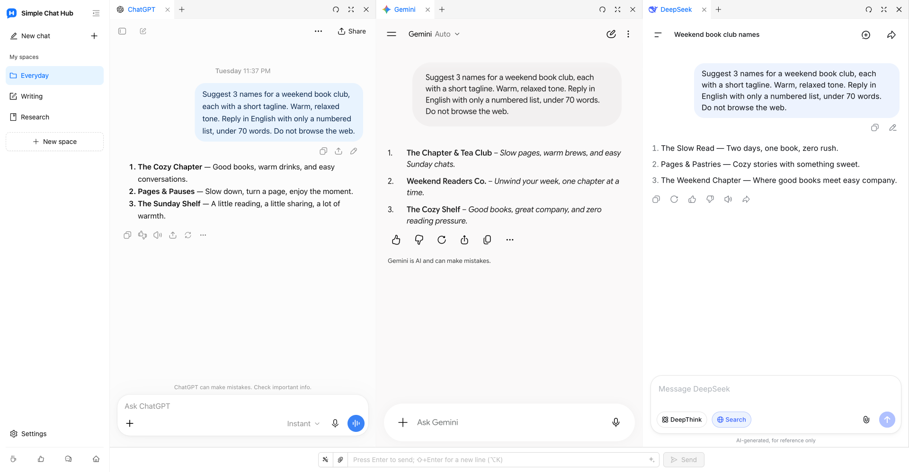

  

# Simple Chat Hub

**Your favorite AIs. One simple place.**

[Website](https://chathub.aipilot.cc/?lang=en) · [Feedback](https://chathub.aipilot.cc/feedback?lang=en) · [Changelog](CHANGELOG.md)

**[English](README.md)** · [简体中文](README_CN.md) · [繁體中文](README_TW.md) · [Español](README_ES.md) · [العربية](README_AR.md) · [Русский](README_RU.md) · [Français](README_FR.md) · [Deutsch](README_DE.md) · [Português (Portugal)](README_PT_PT.md) · [Português (Brasil)](README_PT_BR.md) · [日本語](README_JA.md) · [한국어](README_KO.md)

Simple Chat Hub brings ChatGPT, Gemini, DeepSeek and other AI platforms into one workspace. Chat on the familiar original websites, or send the same question to several AIs and read their answers side by side for different perspectives.

Less searching for a starting point. Fewer tabs to switch. Make everyday AI a little easier.

Actual product screenshot with the new workspace layout and logo, using real conversations on ChatGPT, Gemini and DeepSeek.

## Features

- **One place. Ask together.** Keep your go-to platforms close. Chat with each one independently, or type once to ask several platforms together and follow up with each one separately.
- **Spaces for your tasks.** Save different platform combinations for writing, research and everyday use. Give spaces your own names and icons, and organize pages with groups and tabs.
- **Room for the answer.** Drag column borders to adjust widths, reorder columns and tabs, or collapse the sidebar for easier reading.
- **Good prompts, ready again.** Save useful instructions in your prompt library, call them up when needed, or use prompt optimization to express an idea more clearly.
- **Chats saved as one long image.** Capture a conversation from a single platform, then open a local preview for revisiting, organizing and sharing.
- **Fewer repeated actions.** Use custom keyboard shortcuts and send file attachments through the shared input on compatible platforms.
- **Launch from other tools.** Add a space launch link to Alfred or another launcher to open Hub with a question, ready to edit or send automatically.
- **Keep your familiar accounts.** Open the original AI websites, add custom sites, and switch between light and dark themes and 12 interface languages. No Hub account or API key is required. The extension is free.

## Install

Install from your browser's official extension store:

- [Chrome Web Store](https://chromewebstore.google.com/detail/dpfkgaedamhcmkkgeiajeggihmfjhhlj)
- [Microsoft Edge Add-ons](https://microsoftedge.microsoft.com/addons/detail/simple-chat-hub/plaobjkecadfmaglmhdaolohmckjgnom)
- [Firefox Add-ons](https://addons.mozilla.org/firefox/addon/simple-chat-hub/)

For offline installation, download a packaged file from the [repository file list](https://github.com/jackyr/simple-chat-hub-extension): `.crx.zip` for Chrome / Edge or `.xpi.zip` for Firefox. Extract the archive before installing. Manual installation is subject to browser and operating system restrictions; store installation is recommended.

## Get started

1. Install the extension and open Simple Chat Hub.
2. Choose your favorite platforms and arrange them into spaces.
3. Sign in where needed, then chat on each platform or use the shared input to ask several AIs together.

AI platform accounts, subscriptions, usage limits and network requirements are set by each platform. Page embedding, shared sending, file sending and capture support depend on the platform, login state and network environment. If a platform needs sign-in or verification, complete it in a separate tab first.

## Open Hub from Alfred or another launcher

1. Hover over the desired space in the sidebar and choose **Copy launch link** from its menu.
2. Paste the copied link into your launcher's URL action. It already contains your installation's Hub address and the selected platforms.
3. Have the launcher replace `{query}` with the question, URL-encoded once, and open a **new tab** in the browser and profile where the extension is installed.
4. The copied link includes `send=1` to send after the platforms are ready. Remove `send=1` to fill the shared input without sending.

Use your own copied link: extension addresses vary between browsers, profiles and installation methods. See the [website FAQ](https://chathub.aipilot.cc/?lang=en#faq) for more help.

## Platforms

Built-in platforms include ChatGPT, Gemini, Claude, DeepSeek, Copilot, Grok, Perplexity, Qwen, Kimi, Doubao, Yuanbao, Mistral, Meta and Z.ai, among others. You can also add custom websites in Settings.

## Data and privacy

- Spaces, saved prompts, shortcuts and preferences are stored in browser extension storage.
- Questions, attachments and conversations sent to AI platforms are handled by those platforms under their own policies.
- When you use prompt optimization, the current prompt is sent to the extension's optimization service.
- The extension requests configuration and version information and sends an installation identifier, usage events and error information for usage statistics and troubleshooting. Feedback and surveys send the submitted information.

## Feedback

Report a problem or suggest an improvement through the [feedback page](https://chathub.aipilot.cc/feedback?lang=en) or [GitHub Issues](https://github.com/jackyr/simple-chat-hub-extension/issues). For a bug report, include the platform, browser, extension version and steps to reproduce it.

## Donations

Developing and maintaining this is not easy. If you like this extension or find it helpful, buy me a cup of coffee!

| [Buy Me A Coffee](https://buymeacoffee.com/jackyrao)                                                                          | [PayPal](https://paypal.me/jackyrao)                                                                             | WeChat                                                  |
| ----------------------------------------------------------------------------------------------------------------------------- | ---------------------------------------------------------------------------------------------------------------- | ------------------------------------------------------- |
|  |  |  |

## Donors

Thank you to our wonderful sponsors for the project! Your support helps keep it alive.

[View the donor list](DONORS.md)
