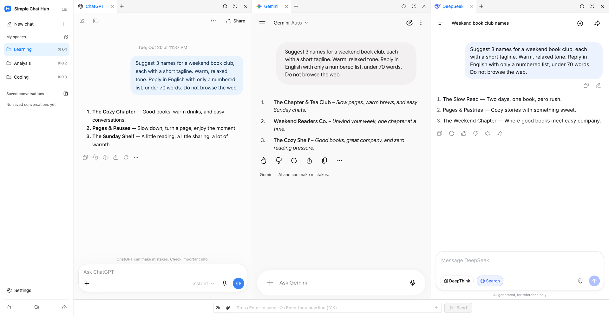

  

# Simple Chat Hub

**Ask once. AI answers, side by side.**

[Website](https://chathub.aipilot.cc/?lang=en) · [Feedback](https://chathub.aipilot.cc/feedback?lang=en) · [Changelog](CHANGELOG.md)

**[English](README.md)** · [简体中文](README_CN.md) · [繁體中文](README_TW.md) · [Español](README_ES.md) · [العربية](README_AR.md) · [Русский](README_RU.md) · [Français](README_FR.md) · [Deutsch](README_DE.md) · [Português (Portugal)](README_PT_PT.md) · [Português (Brasil)](README_PT_BR.md) · [日本語](README_JA.md) · [한국어](README_KO.md)

Simple Chat Hub puts the websites of ChatGPT, Gemini, DeepSeek, Doubao, Kimi and other AI platforms side by side in one window. Type a question once in the shared input: each platform receives it and answers. Keep chatting on whichever platform you want to explore further.

Use the platforms’ own websites and your existing accounts. No API key or Simple Chat Hub account is needed.

Real product interface

## Ways to use it

- **Understand a concept.** Ask how correlation and causation differ, compare examples and explanations, then follow up on the platform that explains it most clearly.
- **Review information.** Give several AIs the same team update, compare their key points and questions to investigate, then check the original material.
- **Troubleshoot a technical problem.** Ask why a page sends the same API request twice, compare approaches and explore one in more depth.

## Features

- **Ask once, compare side by side.** Send the same question to every platform in the current space through the shared input. Read their answers side by side. Add files by selecting, pasting or dragging them in.
- **Follow up separately.** Each platform keeps its own conversation context. Follow up in any platform’s input, or use just one platform.
- **Spaces for your tasks.** Save different platform combinations for learning, analysis and coding. Choose names and icons, and switch with keyboard shortcuts. Keep multiple platform tabs per column, adjust column widths and collapse the sidebar.
- **Save conversations and return anytime.** Save the platforms’ current conversation links and layout, then reopen them with one click.
- **Prompt library.** Save useful instructions and insert them with a click or shortcut. Use prompt optimization to express your ideas more clearly.
- **Long screenshots.** Save a complete conversation from one platform as a long image, with a width suited to desktop or mobile reading.
- **Launch from other tools.** Copy a launch link from the space menu, configure it in Alfred or another launcher, and open Hub with a question to send automatically or just fill in.
- **More details.** Over 30 built-in AI platforms from China and around the world, plus custom websites. Custom shortcuts, light and dark themes, and 12 interface languages.

## Install

**Desktop app** · Windows / macOS / Linux

[Download app](https://chathub.aipilot.cc/?lang=en#download) · [GitHub Releases](https://github.com/jackyr/simple-chat-hub-extension/releases)

The macOS and Windows installers are currently not signed with a developer certificate, and the macOS app has not been notarized by Apple. When you first install or open the app, your system may report that it cannot verify the developer or publisher. Get installers from the official download page or this project’s GitHub Releases. On macOS, open the DMG and move the app to Applications. If the first launch is blocked, confirm you trust the download, then open System Settings → Privacy & Security, scroll to Security, and choose Open Anyway. Confirm Open and authenticate if prompted.

Install from your browser's official extension store:

- [Chrome Web Store](https://chromewebstore.google.com/detail/dpfkgaedamhcmkkgeiajeggihmfjhhlj)
- [Microsoft Edge Add-ons](https://microsoftedge.microsoft.com/addons/detail/simple-chat-hub/plaobjkecadfmaglmhdaolohmckjgnom)
- [Firefox Add-ons](https://addons.mozilla.org/firefox/addon/simple-chat-hub/)

For offline installation, download a packaged file from the [repository file list](https://github.com/jackyr/simple-chat-hub-extension): `.crx.zip` for Chrome / Edge or `.xpi.zip` for Firefox. Extract the archive before installing. Manual installation is subject to browser and operating system restrictions; store installation is recommended.

## Get started

1. Install the extension and click the Simple Chat Hub icon in your browser toolbar.
2. Sign in to the platforms you need in their columns. If sign-in does not work inside a column, sign in in a new browser tab, then refresh the column.
3. Choose your platform combination and save it as a space.
4. Ask through the shared input, read answers side by side and follow up wherever you want to go deeper.

The extension is free. Accounts, subscriptions, usage limits and network requirements are set by each platform. Automatic filling and sending depend on website structure. Platform updates may temporarily require manual sending; we maintain support through configuration updates. Attachment delivery also depends on the platform. A few platforms, such as Grok, cannot be used normally in the extension; use the desktop client or open them in a new tab.

## Open Hub from Alfred or another launcher

1. Hover over the desired space in the sidebar and choose **Copy launch link** from its menu.
2. Paste the copied link into your launcher's URL action. It already contains your installation's Hub address and the selected platforms.
3. Have the launcher replace `{query}` with the question, URL-encoded once, and open a **new tab** in the browser and profile where the extension is installed.
4. The copied link includes `send=1` to send after the platforms are ready. Remove `send=1` to fill the shared input without sending.

Use your own copied link: extension addresses vary between browsers, profiles and installation methods. See the [website FAQ](https://chathub.aipilot.cc/?lang=en#faq) for more help.

## Platforms

Built-in platforms include ChatGPT, Gemini, Claude, DeepSeek, Copilot, Grok, Perplexity, Qwen, Kimi, Doubao, Yuanbao, Mistral, Meta and Z.ai, among others. You can also add custom websites in Settings.

## Data and privacy

Your personal data, including spaces, prompt library entries and saved conversation links, is stored locally. Questions and attachments are sent to the AI platforms you choose.

We use Google Analytics to anonymously collect basic interface usage statistics (such as button clicks and keyboard shortcuts) and error statistics to improve the product.

When you use prompt optimization, the text you enter is sent to Simple Chat Hub servers for processing. We do not collect or store this text.

## Feedback

Report a problem or suggest an improvement through the [feedback page](https://chathub.aipilot.cc/feedback?lang=en) or [GitHub Issues](https://github.com/jackyr/simple-chat-hub-extension/issues). For a bug report, include the platform, browser, extension version and steps to reproduce it.

## Donations

Developing and maintaining this is not easy. If you like this extension or find it helpful, buy me a cup of coffee!

| [Buy Me A Coffee](https://buymeacoffee.com/jackyrao)                                                                          | [PayPal](https://paypal.me/jackyrao)                                                                             | WeChat                                                  |
| ----------------------------------------------------------------------------------------------------------------------------- | ---------------------------------------------------------------------------------------------------------------- | ------------------------------------------------------- |
|  |  |  |

## Donors

Thank you to our wonderful sponsors for the project! Your support helps keep it alive.

[View the donor list](DONORS.md)
