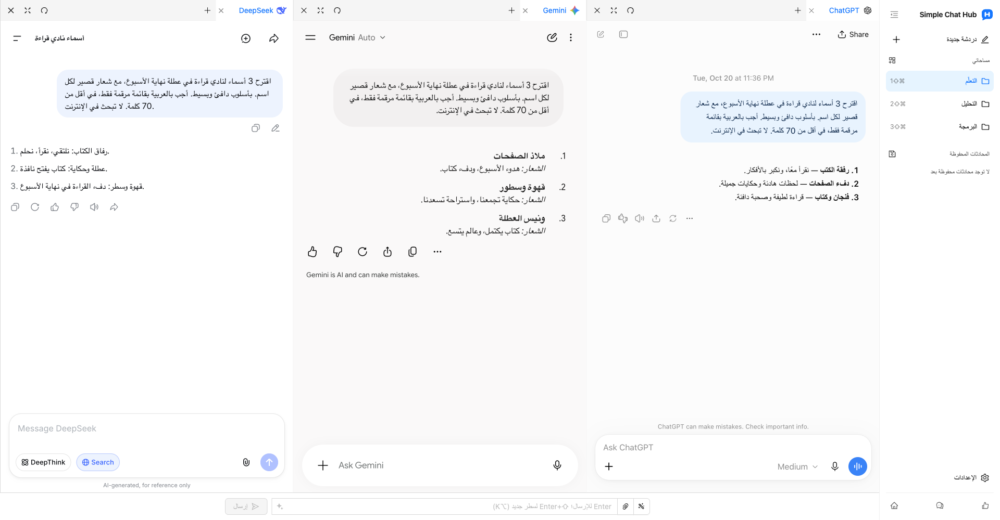

  

# Simple Chat Hub

**سؤال واحد. إجابات الذكاء الاصطناعي جنبًا إلى جنب.**

[الموقع](https://chathub.aipilot.cc/?lang=ar) · [الملاحظات](https://chathub.aipilot.cc/feedback?lang=ar) · [سجل التغييرات](CHANGELOG.md)

[English](README.md) · [简体中文](README_CN.md) · [繁體中文](README_TW.md) · [Español](README_ES.md) · **[العربية](README_AR.md)** · [Русский](README_RU.md) · [Français](README_FR.md) · [Deutsch](README_DE.md) · [Português (Portugal)](README_PT_PT.md) · [Português (Brasil)](README_PT_BR.md) · [日本語](README_JA.md) · [한국어](README_KO.md)

يجمع Simple Chat Hub مواقع ChatGPT وGemini وDeepSeek وDoubao وKimi وغيرها من منصات الذكاء الاصطناعي جنبًا إلى جنب في نافذة واحدة. اكتب السؤال مرة واحدة في حقل الإدخال المشترك، فتتلقاه كل منصة وتجيب. تابع الحوار مع المنصة التي تريد التعمق فيها.

تستخدم مواقع المنصات نفسها وحساباتك التي سجلت الدخول إليها. لا تحتاج إلى مفتاح API أو إنشاء حساب في Simple Chat Hub.

واجهة المنتج الفعلية

## طرق الاستخدام

- **فهم مفهوم.** اسأل مثلًا عن الفرق بين الارتباط والسببية، وقارن الأمثلة والشروح، ثم تابع مع المنصة التي تقدم أوضح شرح.
- **تحليل معلومات.** أعطِ عدة منصات التقرير الأسبوعي نفسه للفريق. قارن النقاط الرئيسية والأسئلة التي تحتاج إلى تحقق، ثم ارجع إلى المادة الأصلية.
- **تشخيص مشكلة تقنية.** اسأل لماذا ترسل الصفحة طلب API نفسه مرتين. قارن مسارات التشخيص وتعمق في أحدها.

## الميزات

- **سؤال واحد وإجابات جنبًا إلى جنب.** أرسل السؤال نفسه إلى جميع منصات المساحة الحالية من حقل الإدخال المشترك. أرفق الملفات باختيارها أو لصقها أو سحبها.
- **محادثات مستقلة.** تحتفظ كل منصة بسياقها الخاص. تابع الأسئلة في حقلها أو استخدم منصة واحدة فقط.
- **مساحات بحسب المهمة.** احفظ مجموعات مختلفة للتعلّم والتحليل والبرمجة، واختر أسماءها وأيقوناتها وانتقل بينها بالاختصارات. ضع عدة تبويبات في عمود، وعدّل عرض الأعمدة واطوِ الشريط الجانبي.
- **حفظ المحادثات واستئنافها.** احفظ روابط المحادثات الحالية وترتيب المنصات، وعد إليها بنقرة واحدة.
- **مكتبة التعليمات.** احفظ التعليمات المتكررة وأدرجها بنقرة أو اختصار. يساعد تحسين التعليمات في التعبير عن أفكارك بوضوح أكبر.
- **لقطات طويلة.** احفظ محادثة كاملة من منصة واحدة في صورة بعرض مناسب للكمبيوتر أو الهاتف.
- **التشغيل من أدوات خارجية.** انسخ رابطًا من قائمة المساحة واضبطه في Alfred أو مشغّل آخر. افتح Hub بسؤال لإرساله تلقائيًا أو لملئه فقط.
- **مزيد من التفاصيل.** أكثر من 30 منصة صينية وعالمية مدمجة، مع إمكانية إضافة مواقع مخصصة، واختصارات قابلة للتعديل، ومظهر فاتح وداكن، و12 لغة للواجهة.

## التثبيت

**تطبيق سطح المكتب** · Windows / macOS / Linux

[تنزيل التطبيق](https://chathub.aipilot.cc/?lang=ar#download) · [GitHub Releases](https://github.com/jackyr/simple-chat-hub-extension/releases)

حزم التثبيت لنظامي macOS وWindows غير موقّعة حاليًا بشهادة مطوّر، ولم تخضع نسخة macOS للتوثيق لدى Apple. عند تثبيت التطبيق أو فتحه لأول مرة، قد يفيد النظام بأنه لا يستطيع التحقق من المطوّر أو الناشر. احصل على حزم التثبيت من صفحة التنزيل الرسمية أو من GitHub Releases لهذا المشروع. في macOS، افتح ملف DMG وانقل التطبيق إلى «التطبيقات». إذا مُنع فتحه لأول مرة، فتأكد من موثوقية مصدر التنزيل، ثم افتح «إعدادات النظام ← الخصوصية والأمن»، وانتقل إلى «الأمن» واختر «فتح على أي حال». أكّد الفتح وتحقّق من هويتك إذا طُلب منك ذلك.

ثبّت الإضافة من المتجر الرسمي لمتصفحك:

- [Chrome Web Store](https://chromewebstore.google.com/detail/dpfkgaedamhcmkkgeiajeggihmfjhhlj)
- [Microsoft Edge Add-ons](https://microsoftedge.microsoft.com/addons/detail/simple-chat-hub/plaobjkecadfmaglmhdaolohmckjgnom)
- [Firefox Add-ons](https://addons.mozilla.org/firefox/addon/simple-chat-hub/)

للتثبيت دون الاتصال بالمتجر، نزّل حزمة من [قائمة ملفات المستودع](https://github.com/jackyr/simple-chat-hub-extension): استخدم `.crx.zip` لمتصفح Chrome / Edge أو `.xpi.zip` لمتصفح Firefox. فك ضغط الملف قبل التثبيت. يخضع التثبيت اليدوي لقيود المتصفح ونظام التشغيل؛ لذا نوصي بالمتاجر الرسمية.

## البدء

1. ثبّت الإضافة وانقر أيقونة Simple Chat Hub في شريط أدوات المتصفح.
2. سجّل الدخول إلى المنصات المطلوبة داخل أعمدتها. إذا تعذّر ذلك داخل العمود، سجّل الدخول في تبويب جديد بالمتصفح ثم حدّث العمود.
3. اختر مجموعة المنصات واحفظها كمساحة خاصة بك.
4. اسأل من حقل الإدخال المشترك واقرأ الإجابات جنبًا إلى جنب، ثم تابع حيث تريد التعمق.

الإضافة مجانية. تحدد كل منصة حساباتها واشتراكاتها وحصص الاستخدام ومتطلبات الشبكة. يعتمد الملء والإرسال التلقائيان على بنية المواقع. قد يلزم الإرسال اليدوي مؤقتًا بعد تغييرات المواقع؛ ونواصل تكييف الدعم عبر تحديثات الإعدادات. يعتمد نجاح إرسال المرفقات أيضًا على المنصة. بعض المنصات، مثل Grok، لا تعمل بصورة طبيعية داخل الإضافة؛ استخدم تطبيق الكمبيوتر أو افتحها في تبويب جديد.

## فتح Hub من Alfred أو أداة تشغيل أخرى

1. مرّر المؤشر فوق المساحة المطلوبة في الشريط الجانبي، واختر **نسخ رابط التشغيل** من قائمتها.
2. ألصق الرابط في إجراء فتح عنوان URL بأداة التشغيل. يتضمن الرابط بالفعل عنوان Hub الخاص بنسختك والمنصات المحددة.
3. اضبط أداة التشغيل لاستبدال `{query}` بالسؤال بعد ترميزه لعنوان URL مرة واحدة فقط، وفتح **علامة تبويب جديدة** في المتصفح والملف الشخصي المثبّتة فيهما الإضافة.
4. يتضمن الرابط المنسوخ `send=1` لإرسال السؤال بعد أن تصبح المنصات جاهزة. احذف `send=1` لتعبئة حقل الإدخال المشترك دون إرسال.

استخدم الرابط الذي نسخته بنفسك؛ فعناوين الإضافات تختلف باختلاف المتصفح والملف الشخصي وطريقة التثبيت. راجع [الأسئلة الشائعة على الموقع](https://chathub.aipilot.cc/?lang=ar#faq) لمزيد من المساعدة.

## المنصات

تتضمن المنصات المدمجة ChatGPT وGemini وClaude وDeepSeek وCopilot وGrok وPerplexity وQwen وKimi وDoubao وYuanbao وMistral وMeta وZ.ai وغيرها. ويمكنك أيضًا إضافة مواقع مخصّصة من الإعدادات.

## البيانات والخصوصية

تُحفظ بياناتك الشخصية، بما فيها المساحات ومكتبة المطالبات وروابط المحادثات المحفوظة، محليًا. وتُرسل الأسئلة والمرفقات إلى منصات الذكاء الاصطناعي التي تختارها.

نستخدم Google Analytics لجمع إحصاءات أساسية مجهولة الهوية عن استخدام الواجهة (مثل نقرات الأزرار واختصارات لوحة المفاتيح) والأخطاء لتحسين المنتج.

عند استخدام تحسين المطالبة، يُرسل النص الذي تدخله إلى خوادم Simple Chat Hub لمعالجته. ولا نجمع هذا النص أو نخزّنه.

## الملاحظات

أبلغ عن مشكلة أو اقترح تحسينًا عبر [صفحة الملاحظات](https://chathub.aipilot.cc/feedback?lang=ar) أو [GitHub Issues](https://github.com/jackyr/simple-chat-hub-extension/issues). عند الإبلاغ عن خطأ، أرفق اسم المنصة والمتصفح وإصدار الإضافة وخطوات إعادة إظهار المشكلة.

## التبرعات

يتطلب التطوير والصيانة وقتًا وجهدًا. إذا أعجبتك الإضافة أو وجدتها مفيدة، يمكنك دعوتي إلى فنجان قهوة!

| [Buy Me A Coffee](https://buymeacoffee.com/jackyrao)                                                                          | [PayPal](https://paypal.me/jackyrao)                                                                             | WeChat                                                  |
| ----------------------------------------------------------------------------------------------------------------------------- | ---------------------------------------------------------------------------------------------------------------- | ------------------------------------------------------- |
|  |  |  |

## الداعمون

شكرًا لكل من يدعم المشروع! دعمكم يساعد على استمرار تطويره.

[عرض قائمة الداعمين](DONORS.md)

