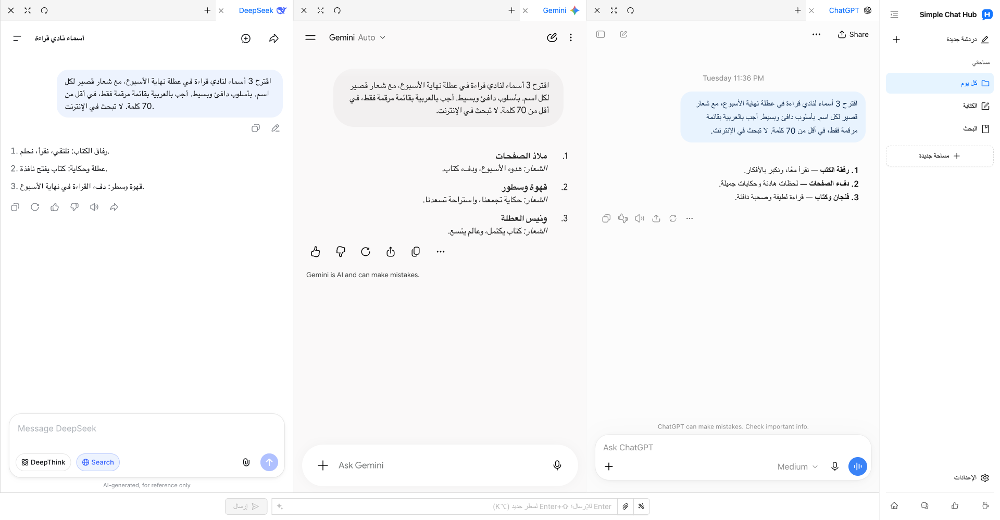

  

# Simple Chat Hub

**أدوات الذكاء الاصطناعي المفضلة لديك، في مكان واحد.**

[الموقع](https://chathub.aipilot.cc/?lang=ar) · [الملاحظات](https://chathub.aipilot.cc/feedback?lang=ar) · [سجل التغييرات](CHANGELOG.md)

[English](README.md) · [简体中文](README_CN.md) · [繁體中文](README_TW.md) · [Español](README_ES.md) · **[العربية](README_AR.md)** · [Русский](README_RU.md) · [Français](README_FR.md) · [Deutsch](README_DE.md) · [Português (Portugal)](README_PT_PT.md) · [Português (Brasil)](README_PT_BR.md) · [日本語](README_JA.md) · [한국어](README_KO.md)

يجمع Simple Chat Hub منصات مثل ChatGPT وGemini وDeepSeek في مساحة عمل واحدة. تحاور في المواقع الأصلية التي تعرفها، أو أرسل السؤال نفسه إلى عدة أدوات واقرأ إجاباتها جنبًا إلى جنب للاطّلاع على وجهات نظر مختلفة.

بحث أقل عن نقطة البداية، وتنقّل أقل بين علامات التبويب. ليصبح استخدام الذكاء الاصطناعي يوميًا أسهل قليلًا.

لقطة فعلية للمنتج بتخطيط المساحات والشعار الجديدين، تعرض محادثات حقيقية في ChatGPT وGemini وDeepSeek.

## الميزات

- **مكان واحد. اسأل الجميع معًا.** أبقِ منصاتك المعتادة في متناول يدك. تحاور مع كل منصة على حدة، أو اكتب السؤال مرة واحدة لطرحه على عدة أدوات ذكاء اصطناعي، ثم تابع كل محادثة بشكل مستقل.
- **مساحات تناسب مهامك.** احفظ مجموعات مختلفة من المنصات للكتابة والبحث والاستخدام اليومي. خصّص أسماء المساحات وأيقوناتها، ونظّم الصفحات في مجموعات وعلامات تبويب.
- **مساحة أوسع للإجابات.** اسحب حدود الأعمدة لتعديل عرضها، وأعد ترتيب الأعمدة وعلامات التبويب، أو اطوِ الشريط الجانبي لقراءة أكثر راحة.
- **تعليمات جيدة، جاهزة للاستخدام مجددًا.** احفظ التعليمات المفيدة في مكتبة التعليمات واستدعها عند الحاجة. ويمكن أن يساعدك تحسين التعليمات على التعبير عن فكرتك بوضوح أكبر.
- **المحادثة في صورة طويلة واحدة.** التقط محادثة من منصة واحدة وافتح معاينة محلية للرجوع إليها أو تنظيمها أو مشاركتها.
- **خطوات متكررة أقل.** خصّص اختصارات لوحة المفاتيح وأرسل الملفات المرفقة من حقل الإدخال المشترك على المنصات المتوافقة.
- **افتحه من أدوات أخرى.** أضف رابط تشغيل مساحة إلى Alfred أو أداة تشغيل أخرى لفتح Hub مع سؤال جاهز للتحرير أو الإرسال التلقائي.
- **احتفظ بحساباتك المعتادة.** افتح المواقع الأصلية لمنصات الذكاء الاصطناعي، وأضف مواقع مخصّصة، وبدّل بين المظهر الفاتح والداكن واختر من بين 12 لغة للواجهة. لا تحتاج إلى حساب Hub أو مفتاح API. الإضافة مجانية.

## التثبيت

ثبّت الإضافة من المتجر الرسمي لمتصفحك:

- [Chrome Web Store](https://chromewebstore.google.com/detail/dpfkgaedamhcmkkgeiajeggihmfjhhlj)
- [Microsoft Edge Add-ons](https://microsoftedge.microsoft.com/addons/detail/simple-chat-hub/plaobjkecadfmaglmhdaolohmckjgnom)
- [Firefox Add-ons](https://addons.mozilla.org/firefox/addon/simple-chat-hub/)

للتثبيت دون الاتصال بالمتجر، نزّل حزمة من [قائمة ملفات المستودع](https://github.com/jackyr/simple-chat-hub-extension): استخدم `.crx.zip` لمتصفح Chrome / Edge أو `.xpi.zip` لمتصفح Firefox. فك ضغط الملف قبل التثبيت. يخضع التثبيت اليدوي لقيود المتصفح ونظام التشغيل؛ لذا نوصي بالمتاجر الرسمية.

## البدء

1. ثبّت الإضافة وافتح Simple Chat Hub.
2. اختر منصاتك المفضلة ونظّمها في مساحات.
3. سجّل الدخول عند الحاجة، ثم تحاور في كل منصة أو استخدم حقل الإدخال المشترك لسؤال عدة أدوات ذكاء اصطناعي معًا.

تحدد كل منصة ذكاء اصطناعي حساباتها واشتراكاتها وحدود الاستخدام ومتطلبات الشبكة. ويعتمد تضمين الصفحات والإرسال المشترك وإرسال الملفات والتقاط المحادثات على المنصة وحالة تسجيل الدخول والشبكة. إذا طلبت منصة تسجيل الدخول أو إتمام تحقق، فأكمل ذلك أولًا في علامة تبويب منفصلة.

## فتح Hub من Alfred أو أداة تشغيل أخرى

1. مرّر المؤشر فوق المساحة المطلوبة في الشريط الجانبي، واختر **نسخ رابط التشغيل** من قائمتها.
2. ألصق الرابط في إجراء فتح عنوان URL بأداة التشغيل. يتضمن الرابط بالفعل عنوان Hub الخاص بنسختك والمنصات المحددة.
3. اضبط أداة التشغيل لاستبدال `{query}` بالسؤال بعد ترميزه لعنوان URL مرة واحدة فقط، وفتح **علامة تبويب جديدة** في المتصفح والملف الشخصي المثبّتة فيهما الإضافة.
4. يتضمن الرابط المنسوخ `send=1` لإرسال السؤال بعد أن تصبح المنصات جاهزة. احذف `send=1` لتعبئة حقل الإدخال المشترك دون إرسال.

استخدم الرابط الذي نسخته بنفسك؛ فعناوين الإضافات تختلف باختلاف المتصفح والملف الشخصي وطريقة التثبيت. راجع [الأسئلة الشائعة على الموقع](https://chathub.aipilot.cc/?lang=ar#faq) لمزيد من المساعدة.

## المنصات

تتضمن المنصات المدمجة ChatGPT وGemini وClaude وDeepSeek وCopilot وGrok وPerplexity وQwen وKimi وDoubao وYuanbao وMistral وMeta وZ.ai وغيرها. ويمكنك أيضًا إضافة مواقع مخصّصة من الإعدادات.

## البيانات والخصوصية

- تُحفظ المساحات والتعليمات المحفوظة والاختصارات والتفضيلات في مساحة تخزين إضافات المتصفح.
- تُعالَج الأسئلة والمرفقات والمحادثات المرسلة إلى منصات الذكاء الاصطناعي بواسطة تلك المنصات وفق سياساتها الخاصة.
- عند استخدام تحسين التعليمات، تُرسل التعليمات الحالية إلى خدمة التحسين الخاصة بالإضافة.
- تطلب الإضافة معلومات الإعداد والإصدار، وترسل معرّف التثبيت وأحداث الاستخدام ومعلومات الأخطاء لإحصاءات الاستخدام وتشخيص المشكلات. وتُرسل الملاحظات والاستبيانات المعلومات التي تقدّمها.

## الملاحظات

أبلغ عن مشكلة أو اقترح تحسينًا عبر [صفحة الملاحظات](https://chathub.aipilot.cc/feedback?lang=ar) أو [GitHub Issues](https://github.com/jackyr/simple-chat-hub-extension/issues). عند الإبلاغ عن خطأ، أرفق اسم المنصة والمتصفح وإصدار الإضافة وخطوات إعادة إظهار المشكلة.

## التبرعات

يتطلب التطوير والصيانة وقتًا وجهدًا. إذا أعجبتك الإضافة أو وجدتها مفيدة، يمكنك دعوتي إلى فنجان قهوة!

| [Buy Me A Coffee](https://buymeacoffee.com/jackyrao)                                                                          | [PayPal](https://paypal.me/jackyrao)                                                                             | WeChat                                                  |
| ----------------------------------------------------------------------------------------------------------------------------- | ---------------------------------------------------------------------------------------------------------------- | ------------------------------------------------------- |
|  |  |  |

## الداعمون

شكرًا لكل من يدعم المشروع! دعمكم يساعد على استمرار تطويره.

[عرض قائمة الداعمين](DONORS.md)

