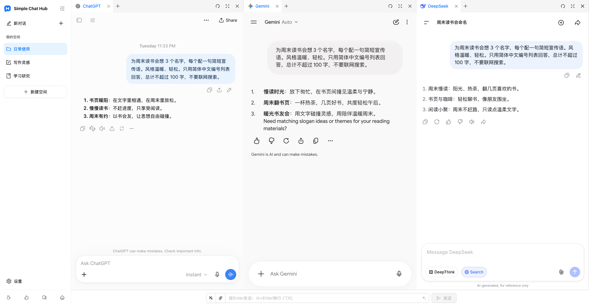

  

# Simple Chat Hub

**常用的 AI，在一起更顺手。**

[官方网站](https://chathub.aipilot.cc/?lang=zh-CN) · [问题反馈](https://chathub.aipilot.cc/feedback?lang=zh-CN) · [更新日志](CHANGELOG.md)

[English](README.md) · **[简体中文](README_CN.md)** · [繁體中文](README_TW.md) · [Español](README_ES.md) · [العربية](README_AR.md) · [Русский](README_RU.md) · [Français](README_FR.md) · [Deutsch](README_DE.md) · [Português (Portugal)](README_PT_PT.md) · [Português (Brasil)](README_PT_BR.md) · [日本語](README_JA.md) · [한국어](README_KO.md)

Simple Chat Hub 把 ChatGPT、Gemini、DeepSeek 等 AI 平台放进一个工作空间。你可以直接在熟悉的平台页面里对话，也可以把同一个问题同时发给多个 AI，并排阅读回答，参考不同思路。

少找入口，少切标签页。让日常使用 AI 更简单。

实际产品截图，展示新版空间布局与 logo，以及 ChatGPT、Gemini、DeepSeek 中的真实对话。

## 主要功能

- **集中使用，同时提问。** 把常用平台放在眼前，随时打开、独立对话。需要多听一种思路时，输入一次，就能同时向多个平台提问，再到各个平台继续追问。
- **按任务整理自己的空间。** 为写作、研究和日常使用保存不同的平台组合，自定义空间名称与图标，使用分组和标签整理页面。
- **为回答留出合适的位置。** 拖动分栏边界调整列宽，拖动排列分栏与标签，也可以收起侧栏，让回答更好读。
- **好提示词，下次直接用。** 将常用指令保存到提示词库，需要时直接调用。也可以使用提示词优化，把已有的想法表达得更清楚。
- **有用的对话，留成一张长图。** 把单个平台的对话保存成长图，在本地打开预览，方便回看、整理与分享。
- **少做重复操作。** 设置适合自己的快捷键，在兼容的平台上通过统一输入栏发送文件附件。
- **从外部工具带着问题打开。** 将空间调用链接配置到 Alfred 等启动器中，带着问题打开 Hub，自动发送或先填入再编辑。
- **沿用熟悉的平台与账号。** 直接打开各 AI 平台的原站，支持添加自定义网站，切换浅色、深色主题及 12 种界面语言。扩展免费，无需注册 Hub 账号，也不需要 API Key。

## 安装

从浏览器官方扩展商店安装：

- [Chrome 扩展商店](https://chromewebstore.google.com/detail/dpfkgaedamhcmkkgeiajeggihmfjhhlj)
- [Microsoft Edge 扩展商店](https://microsoftedge.microsoft.com/addons/detail/simple-chat-hub/plaobjkecadfmaglmhdaolohmckjgnom)
- [Firefox 扩展商店](https://addons.mozilla.org/firefox/addon/simple-chat-hub/)

需要离线安装时，可从[仓库文件列表](https://github.com/jackyr/simple-chat-hub-extension)下载对应安装包：Chrome / Edge 使用 `.crx.zip`，Firefox 使用 `.xpi.zip`，解压后安装。手动安装受浏览器及操作系统限制，建议优先使用官方商店。

## 开始使用

1. 安装扩展，打开 Simple Chat Hub。
2. 选择常用平台，整理成自己的空间。
3. 在需要的平台完成登录，直接对话或通过统一输入栏尝试同时提问。

各 AI 平台的账号、订阅、使用额度和网络要求仍由平台决定。页面嵌入、同步发送、文件发送及对话截图的可用性取决于具体平台、登录状态和网络环境。平台需要登录或验证时，请先在独立标签页中完成。

## 从 Alfred 等外部工具打开 Hub

1. 将鼠标移到侧栏中的目标空间，在菜单中选择**复制调用链接**。
2. 将链接粘贴到启动器的 URL 操作中。链接已包含当前安装的 Hub 地址和所选平台。
3. 让工具把 `{query}` 替换为仅经过一次 URL 编码的问题，并在安装了扩展的浏览器及配置文件中**新建标签页**打开。
4. 复制的链接默认带有 `send=1`，会在平台就绪后自动发送；删除 `send=1` 则只填入统一输入栏，供你继续编辑。

请使用自己复制的链接，不同浏览器、配置文件和安装方式的扩展地址可能不同。更多说明见[官网常见问题](https://chathub.aipilot.cc/?lang=zh-CN#faq)。

## 支持的平台

内置 ChatGPT、Gemini、Claude、DeepSeek、Copilot、Grok、Perplexity、千问、Kimi、豆包、元宝、Mistral、Meta、Z.ai 等平台，也可以在设置中添加自定义网站。

## 数据与隐私

- 空间、提示词库、快捷键和偏好设置保存在浏览器扩展存储中。
- 发送给 AI 平台的问题、附件及对话由相应平台按其政策处理。
- 主动使用提示词优化时，当前提示词会发送至扩展的优化服务。
- 扩展会请求配置和版本信息，并发送安装标识、功能使用事件及错误信息，用于使用统计与故障排查。反馈与问卷会发送所提交的信息。

## 问题反馈

可以通过[反馈页面](https://chathub.aipilot.cc/feedback?lang=zh-CN)或 [GitHub Issues](https://github.com/jackyr/simple-chat-hub-extension/issues)报告问题、提出建议。反馈故障时，请附上平台、浏览器、扩展版本及复现步骤。

## 打赏

开发维护不易，如果您喜欢本扩展或者觉得对您有所帮助，请我喝一杯咖啡吧！

| [Buy Me A Coffee](https://buymeacoffee.com/jackyrao)                                                                          | [PayPal](https://paypal.me/jackyrao)                                                                             | 微信                                                  |
| ----------------------------------------------------------------------------------------------------------------------------- | ---------------------------------------------------------------------------------------------------------------- | ----------------------------------------------------- |
|  |  |  |

## 赞助者

感谢项目的赞助者！您的支持帮助我保持项目的持续发展

[查看赞助者名单](DONORS.md)
