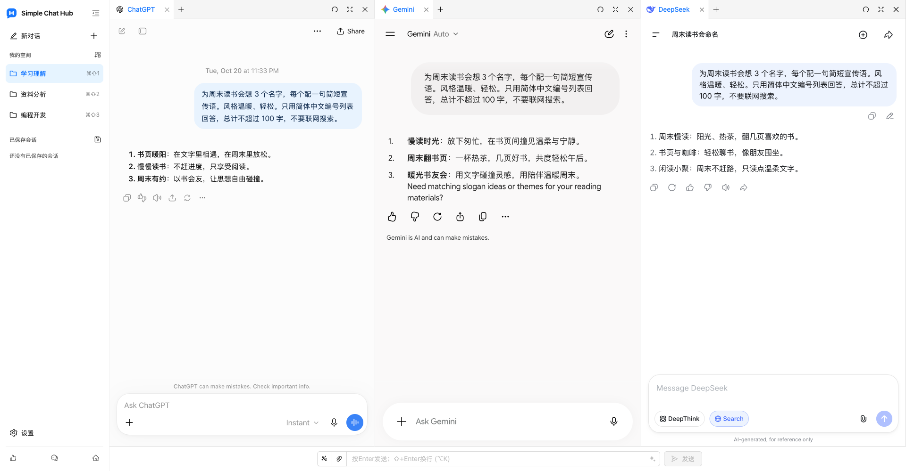

  

# Simple Chat Hub

**一次提问，多个 AI 并排回答。**

[官方网站](https://chathub.aipilot.cc/?lang=zh-CN) · [问题反馈](https://chathub.aipilot.cc/feedback?lang=zh-CN) · [更新日志](CHANGELOG.md)

[English](README.md) · **[简体中文](README_CN.md)** · [繁體中文](README_TW.md) · [Español](README_ES.md) · [العربية](README_AR.md) · [Русский](README_RU.md) · [Français](README_FR.md) · [Deutsch](README_DE.md) · [Português (Portugal)](README_PT_PT.md) · [Português (Brasil)](README_PT_BR.md) · [日本語](README_JA.md) · [한국어](README_KO.md)

Simple Chat Hub 把 ChatGPT、Gemini、DeepSeek、豆包、Kimi 等 AI 平台的网页版并排放在一个窗口里。在统一输入栏写一次问题，各平台同时收到并作答；想深入哪家，就在哪家接着聊。

用的就是各平台网页版和你已登录的账号，不需要 API Key，也不需要注册 Simple Chat Hub 账号。

真实产品界面

## 可以这样使用

- **理解一个概念。**比如问“相关性和因果关系有什么区别”，对照不同的例子和解释，在讲得最清楚的平台继续追问。
- **整理一份资料。**把同一份团队周报交给多个 AI，对照各自提炼的重点和待核实的问题，再回到原始资料核查。
- **排查技术问题。**比如问“页面为什么把同一个 API 请求发了两次”，比较不同的排查思路，选一个方向深入。

## 主要功能

- **一次提问，并排对照。**用统一输入栏把同一个问题发给当前空间里的所有平台，回答并排显示。可以附带文件，点选、粘贴或拖入都可以。
- **各自接着聊。**每个平台保留自己的对话上下文，可以在任意平台的输入框里单独追问，也可以只用其中一个平台。
- **按任务整理空间。**为学习、资料分析、编程等任务保存不同的平台组合，自定义名称和图标，用快捷键切换。一列可以放多个平台标签，拖动分栏调整列宽，侧栏可以收起。
- **保存会话，随时接着聊。**把各平台当前的对话链接和排列保存下来，之后一键回到原来的对话。
- **提示词库。**把常用指令存起来，点选或用快捷键填入；也可以用提示词优化，让想法表达得更清楚。
- **对话长图。**把单个平台的完整对话保存成长图，可选适合电脑或手机阅读的宽度。
- **从外部工具打开。**在空间菜单复制调用链接，配置到 Alfred 等启动器，带着问题打开 Hub，自动发送或只填入问题。
- **更多细节。**内置 30 多个国内外 AI 平台，也可以添加自定义网站；支持自定义快捷键、浅色和深色主题，以及 12 种界面语言。

## 安装

**桌面客户端** · Windows / macOS / Linux

[下载客户端](https://chathub.aipilot.cc/?lang=zh-CN#download) · [GitHub Releases](https://github.com/jackyr/simple-chat-hub-extension/releases)

目前，macOS 和 Windows 安装包均未使用开发者证书签名，macOS 版也未经过 Apple 公证。首次安装或打开时，系统可能提示无法验证开发者或发布者。请从官网下载区或本项目的 GitHub Releases 获取安装包。 在 macOS 上，打开 DMG 并将应用拖入“应用程序”。如果首次打开被阻止，请在确认下载来源可信后，打开“系统设置 → 隐私与安全性”，向下滚动到“安全性”并点击“仍要打开”；再次确认打开，并按提示验证身份。

从浏览器官方扩展商店安装：

- [Chrome 扩展商店](https://chromewebstore.google.com/detail/dpfkgaedamhcmkkgeiajeggihmfjhhlj)
- [Microsoft Edge 扩展商店](https://microsoftedge.microsoft.com/addons/detail/simple-chat-hub/plaobjkecadfmaglmhdaolohmckjgnom)
- [Firefox 扩展商店](https://addons.mozilla.org/firefox/addon/simple-chat-hub/)

需要离线安装时，可从[仓库文件列表](https://github.com/jackyr/simple-chat-hub-extension)下载对应安装包：Chrome / Edge 使用 `.crx.zip`，Firefox 使用 `.xpi.zip`，解压后安装。手动安装受浏览器及操作系统限制，建议优先使用官方商店。

## 开始使用

1. 安装扩展，点击浏览器工具栏中的 Simple Chat Hub 图标打开。
2. 在各栏中登录需要的平台。如果某个平台无法在栏内登录，先在浏览器的新标签页中登录，再回来刷新这一栏。
3. 选好平台组合，保存成自己的空间。
4. 在统一输入栏提问，并排阅读回答，在想深入的平台继续追问。

扩展免费。各平台的账号、订阅、使用额度和网络要求由平台决定。自动填写和发送依赖各平台网页的结构，个别平台改版后可能需要暂时手动发送，我们会通过配置更新持续适配；附件能否发送成功也取决于平台本身。少数平台（如 Grok）无法在扩展中正常使用，可以改用桌面客户端或在新标签页中打开。

## 从 Alfred 等外部工具打开 Hub

1. 将鼠标移到侧栏中的目标空间，在菜单中选择**复制调用链接**。
2. 将链接粘贴到启动器的 URL 操作中。链接已包含当前安装的 Hub 地址和所选平台。
3. 让工具把 `{query}` 替换为仅经过一次 URL 编码的问题，并在安装了扩展的浏览器及配置文件中**新建标签页**打开。
4. 复制的链接默认带有 `send=1`，会在平台就绪后自动发送；删除 `send=1` 则只填入统一输入栏，供你继续编辑。

请使用自己复制的链接，不同浏览器、配置文件和安装方式的扩展地址可能不同。更多说明见[官网常见问题](https://chathub.aipilot.cc/?lang=zh-CN#faq)。

## 支持的平台

内置 ChatGPT、Gemini、Claude、DeepSeek、Copilot、Grok、Perplexity、千问、Kimi、豆包、元宝、Mistral、Meta、Z.ai 等平台，也可以在设置中添加自定义网站。

## 数据与隐私说明

你的空间、提示词库和已保存对话链接等个人数据均保存在本地。提问和附件会发送给你选择的 AI 平台。

我们会通过 Google Analytics 匿名收集基本的界面使用统计（如按钮点击、快捷键）和错误统计，用于改进产品。

使用“优化提示词”时，输入的文字会发送至 Simple Chat Hub 服务端处理，我们不会收集和保存这些数据。

## 问题反馈

可以通过[反馈页面](https://chathub.aipilot.cc/feedback?lang=zh-CN)或 [GitHub Issues](https://github.com/jackyr/simple-chat-hub-extension/issues)报告问题、提出建议。反馈故障时，请附上平台、浏览器、扩展版本及复现步骤。

## 打赏

开发维护不易，如果您喜欢本扩展或者觉得对您有所帮助，请我喝一杯咖啡吧！

| [Buy Me A Coffee](https://buymeacoffee.com/jackyrao)                                                                          | [PayPal](https://paypal.me/jackyrao)                                                                             | 微信                                                  |
| ----------------------------------------------------------------------------------------------------------------------------- | ---------------------------------------------------------------------------------------------------------------- | ----------------------------------------------------- |
|  |  |  |

## 赞助者

感谢项目的赞助者！您的支持帮助我保持项目的持续发展

[查看赞助者名单](DONORS.md)
