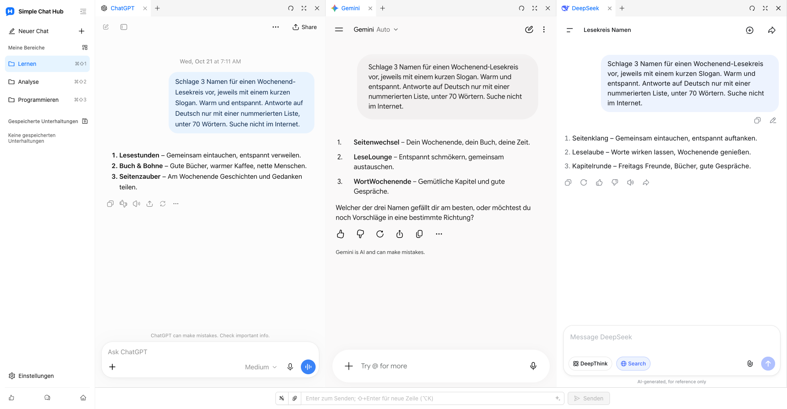

  

# Simple Chat Hub

**Einmal fragen. KI-Antworten nebeneinander.**

[Website](https://chathub.aipilot.cc/?lang=de) · [Feedback](https://chathub.aipilot.cc/feedback?lang=de) · [Änderungsprotokoll](CHANGELOG.md)

[English](README.md) · [简体中文](README_CN.md) · [繁體中文](README_TW.md) · [Español](README_ES.md) · [العربية](README_AR.md) · [Русский](README_RU.md) · [Français](README_FR.md) · **[Deutsch](README_DE.md)** · [Português (Portugal)](README_PT_PT.md) · [Português (Brasil)](README_PT_BR.md) · [日本語](README_JA.md) · [한국어](README_KO.md)

Simple Chat Hub zeigt die Websites von ChatGPT, Gemini, DeepSeek, Doubao, Kimi und weiteren KI-Plattformen nebeneinander in einem Fenster. Schreibe deine Frage einmal ins gemeinsame Eingabefeld: Alle Plattformen erhalten sie und antworten. Chatte dort weiter, wo du mehr erfahren möchtest.

Du nutzt die Websites der Plattformen mit deinen bereits angemeldeten Konten. Weder ein API-Key noch ein Simple-Chat-Hub-Konto ist nötig.

Echte Produktoberfläche

## So kannst du es nutzen

- **Ein Konzept verstehen.** Frage etwa nach dem Unterschied zwischen Korrelation und Kausalität. Vergleiche Beispiele und Erklärungen und frage dort nach, wo die Erklärung am klarsten ist.
- **Informationen aufbereiten.** Gib mehreren KIs denselben Team-Wochenbericht. Vergleiche Kernaussagen und offene Fragen und prüfe sie anhand der Originalunterlagen.
- **Technische Probleme untersuchen.** Frage, warum eine Seite dieselbe API-Anfrage zweimal sendet. Vergleiche Ansätze zur Fehlersuche und vertiefe einen davon.

## Funktionen

- **Einmal fragen, nebeneinander vergleichen.** Sende dieselbe Frage über das gemeinsame Eingabefeld an alle Plattformen im aktuellen Bereich. Lies Antworten nebeneinander. Dateien lassen sich auswählen, einfügen oder hineinziehen.
- **Einzeln weiterchatten.** Jede Plattform behält ihren eigenen Gesprächskontext. Frage im jeweiligen Eingabefeld nach oder nutze nur eine Plattform.
- **Bereiche nach Aufgabe.** Speichere verschiedene Plattformkombinationen für Lernen, Analyse oder Programmierung. Vergib Namen und Symbole und wechsle per Tastenkürzel. Nutze mehrere Tabs pro Spalte, verändere Spaltenbreiten oder klappe die Seitenleiste ein.
- **Unterhaltungen speichern und fortsetzen.** Sichere die aktuellen Gesprächslinks und die Anordnung der Plattformen und kehre mit einem Klick zurück.
- **Prompt-Bibliothek.** Speichere häufige Anweisungen und füge sie per Klick oder Tastenkürzel ein. Die Prompt-Optimierung hilft, Ideen klarer auszudrücken.
- **Lange Screenshots.** Speichere ein vollständiges Gespräch einer Plattform als langes Bild in einer Breite für Desktop oder Smartphone.
- **Aus anderen Tools starten.** Kopiere im Bereichsmenü einen Aufruflink für Alfred oder einen anderen Starter. Öffne Hub mit einer Frage und sende sie automatisch oder trage sie nur ein.
- **Weitere Details.** Über 30 integrierte KI-Plattformen aus China und anderen Ländern sowie eigene Websites. Anpassbare Tastenkürzel, helle und dunkle Themes und 12 Oberflächensprachen.

## Installation

**Desktop-App** · Windows / macOS / Linux

[App herunterladen](https://chathub.aipilot.cc/?lang=de#download) · [GitHub Releases](https://github.com/jackyr/simple-chat-hub-extension/releases)

Die Installationsdateien für macOS und Windows sind derzeit nicht mit einem Entwicklerzertifikat signiert. Die macOS-Version wurde außerdem nicht von Apple notarisiert. Bei der ersten Installation oder beim ersten Öffnen kann das System melden, dass der Entwickler oder Herausgeber nicht verifiziert werden kann. Lade die Installationsdateien von der offiziellen Downloadseite oder aus dem Bereich GitHub Releases dieses Projekts herunter. Öffne unter macOS die DMG-Datei und verschiebe die App in „Programme“. Falls der erste Start blockiert wird, prüfe, ob du der Downloadquelle vertraust. Öffne dann „Systemeinstellungen → Datenschutz & Sicherheit“, scrolle zu „Sicherheit“ und wähle „Dennoch öffnen“. Bestätige das Öffnen und authentifiziere dich bei Aufforderung.

Installiere die Erweiterung aus dem offiziellen Store deines Browsers:

- [Chrome Web Store](https://chromewebstore.google.com/detail/dpfkgaedamhcmkkgeiajeggihmfjhhlj)
- [Microsoft Edge Add-ons](https://microsoftedge.microsoft.com/addons/detail/simple-chat-hub/plaobjkecadfmaglmhdaolohmckjgnom)
- [Firefox Add-ons](https://addons.mozilla.org/firefox/addon/simple-chat-hub/)

Für eine Offline-Installation lade ein Paket aus der [Dateiliste des Repositorys](https://github.com/jackyr/simple-chat-hub-extension) herunter: `.crx.zip` für Chrome / Edge oder `.xpi.zip` für Firefox. Entpacke das Archiv vor der Installation. Die manuelle Installation unterliegt den Einschränkungen deines Browsers und Betriebssystems; die offiziellen Stores werden empfohlen.

## Erste Schritte

1. Installiere die Erweiterung und klicke auf das Simple-Chat-Hub-Symbol in der Browserleiste.
2. Melde dich in den Spalten bei den gewünschten Plattformen an. Falls das dort nicht klappt, melde dich in einem neuen Browser-Tab an und lade die Spalte neu.
3. Wähle deine Plattformkombination und speichere sie als Bereich.
4. Stelle eine Frage im gemeinsamen Eingabefeld, lies die Antworten nebeneinander und frage auf der gewünschten Plattform weiter.

Die Erweiterung ist kostenlos. Konten, Abonnements, Nutzungslimits und Netzwerkanforderungen legt jede Plattform selbst fest. Automatisches Ausfüllen und Senden hängen vom Aufbau der Websites ab. Nach Änderungen kann vorübergehend manuelles Senden nötig sein; wir passen die Unterstützung über Konfigurationsupdates an. Auch das Senden von Anhängen hängt von der Plattform ab. Einige Plattformen wie Grok funktionieren in der Erweiterung nicht regulär. Nutze dafür die Desktop-App oder einen neuen Tab.

## Hub über Alfred oder einen anderen Launcher öffnen

1. Bewege den Mauszeiger über den gewünschten Bereich in der Seitenleiste und wähle im Menü **Startlink kopieren**.
2. Füge den Link in die URL-Aktion deines Launchers ein. Er enthält bereits die Hub-Adresse deiner Installation und die ausgewählten Plattformen.
3. Lass den Launcher `{query}` durch die einmal URL-codierte Frage ersetzen und einen **neuen Tab** in dem Browser und Profil öffnen, in dem die Erweiterung installiert ist.
4. Der kopierte Link enthält `send=1`, damit die Frage gesendet wird, sobald die Plattformen bereit sind. Entferne `send=1`, um das gemeinsame Eingabefeld nur auszufüllen, ohne zu senden.

Verwende deinen selbst kopierten Link: Erweiterungsadressen unterscheiden sich je nach Browser, Profil und Installationsart. Weitere Hilfe findest du in den [FAQ auf der Website](https://chathub.aipilot.cc/?lang=de#faq).

## Plattformen

Zu den integrierten Plattformen gehören unter anderem ChatGPT, Gemini, Claude, DeepSeek, Copilot, Grok, Perplexity, Qwen, Kimi, Doubao, Yuanbao, Mistral, Meta und Z.ai. In den Einstellungen kannst du auch eigene Websites hinzufügen.

## Daten und Datenschutz

Ihre persönlichen Daten, darunter Bereiche, Einträge der Prompt-Bibliothek und Links zu gespeicherten Gesprächen, werden lokal gespeichert. Fragen und Anhänge werden an die von Ihnen gewählten KI-Plattformen gesendet.

Wir nutzen Google Analytics, um anonym grundlegende Statistiken zur Oberflächennutzung (etwa Schaltflächenklicks und Tastenkürzel) und zu Fehlern zu erfassen und damit das Produkt zu verbessern.

Bei der Prompt-Optimierung wird Ihr eingegebener Text zur Verarbeitung an die Server von Simple Chat Hub gesendet. Wir erfassen oder speichern diesen Text nicht.

## Feedback

Melde Probleme oder schlage Verbesserungen über die [Feedback-Seite](https://chathub.aipilot.cc/feedback?lang=de) oder [GitHub Issues](https://github.com/jackyr/simple-chat-hub-extension/issues) vor. Gib bei einem Fehlerbericht die Plattform, den Browser, die Erweiterungsversion und die Schritte zum Reproduzieren an.

## Spenden

Entwicklung und Wartung kosten Zeit und Mühe. Wenn dir die Erweiterung gefällt oder hilft, spendiere mir einen Kaffee!

| [Buy Me A Coffee](https://buymeacoffee.com/jackyrao)                                                                          | [PayPal](https://paypal.me/jackyrao)                                                                             | WeChat                                                  |
| ----------------------------------------------------------------------------------------------------------------------------- | ---------------------------------------------------------------------------------------------------------------- | ------------------------------------------------------- |
|  |  |  |

## Unterstützer

Vielen Dank an alle, die das Projekt unterstützen! Eure Hilfe hält es am Leben.

[Liste der Unterstützer ansehen](DONORS.md)
