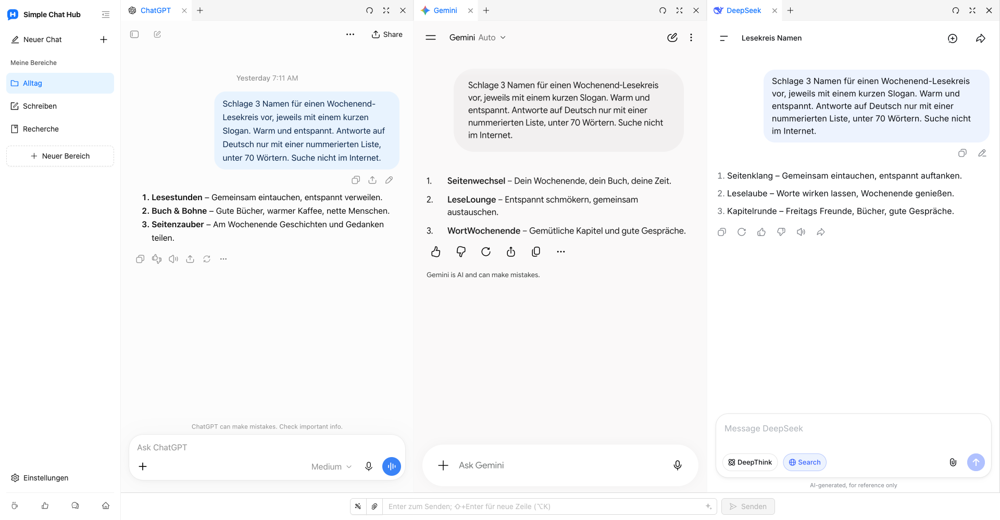

  

# Simple Chat Hub

**Deine liebsten KIs. Ein gemeinsamer Ort.**

[Website](https://chathub.aipilot.cc/?lang=de) · [Feedback](https://chathub.aipilot.cc/feedback?lang=de) · [Änderungsprotokoll](CHANGELOG.md)

[English](README.md) · [简体中文](README_CN.md) · [繁體中文](README_TW.md) · [Español](README_ES.md) · [العربية](README_AR.md) · [Русский](README_RU.md) · [Français](README_FR.md) · **[Deutsch](README_DE.md)** · [Português (Portugal)](README_PT_PT.md) · [Português (Brasil)](README_PT_BR.md) · [日本語](README_JA.md) · [한국어](README_KO.md)

Simple Chat Hub bringt ChatGPT, Gemini, DeepSeek und weitere KI-Plattformen in einen Arbeitsbereich. Chatte auf den vertrauten Originalseiten oder sende dieselbe Frage an mehrere KIs und lies ihre Antworten nebeneinander, um verschiedene Blickwinkel kennenzulernen.

Weniger nach dem Einstieg suchen, weniger Tabs wechseln. So wird KI im Alltag etwas einfacher.

Echter Produkt-Screenshot mit dem neuen Bereichslayout und Logo sowie echten Gesprächen auf ChatGPT, Gemini und DeepSeek.

## Funktionen

- **Ein Ort. Gemeinsam fragen.** Halte deine bevorzugten Plattformen griffbereit. Chatte mit jeder einzeln oder stelle eine Frage einmal an mehrere KIs und führe die Gespräche anschließend unabhängig weiter.
- **Bereiche für deine Aufgaben.** Speichere verschiedene Plattformkombinationen für Schreiben, Recherche und Alltag. Vergib eigene Namen und Symbole für Bereiche und ordne Seiten in Gruppen und Tabs.
- **Mehr Platz für Antworten.** Ziehe Spaltenränder, um die Breite anzupassen, ordne Spalten und Tabs neu oder klappe die Seitenleiste zum bequemeren Lesen ein.
- **Gute Prompts, jederzeit wieder bereit.** Speichere hilfreiche Anweisungen in deiner Prompt-Bibliothek und rufe sie bei Bedarf auf. Mit der Prompt-Optimierung kannst du eine Idee klarer ausdrücken.
- **Gespräche als ein langes Bild speichern.** Erfasse ein Gespräch einer einzelnen Plattform und öffne eine lokale Vorschau, um es später anzusehen, zu ordnen oder zu teilen.
- **Weniger wiederholte Handgriffe.** Lege eigene Tastenkürzel fest und sende auf kompatiblen Plattformen Dateianhänge über das gemeinsame Eingabefeld.
- **Aus anderen Tools starten.** Füge den Startlink eines Bereichs in Alfred oder einen anderen Launcher ein, um Hub mit einer Frage zu öffnen. Du kannst sie weiterbearbeiten oder automatisch senden lassen.
- **Vertraute Konten weiterverwenden.** Öffne die Originalseiten der KI-Plattformen, füge eigene Websites hinzu und wähle zwischen hellem und dunklem Design sowie 12 Oberflächensprachen. Du brauchst weder ein Hub-Konto noch einen API-Key. Die Erweiterung ist kostenlos.

## Installation

Installiere die Erweiterung aus dem offiziellen Store deines Browsers:

- [Chrome Web Store](https://chromewebstore.google.com/detail/dpfkgaedamhcmkkgeiajeggihmfjhhlj)
- [Microsoft Edge Add-ons](https://microsoftedge.microsoft.com/addons/detail/simple-chat-hub/plaobjkecadfmaglmhdaolohmckjgnom)
- [Firefox Add-ons](https://addons.mozilla.org/firefox/addon/simple-chat-hub/)

Für eine Offline-Installation lade ein Paket aus der [Dateiliste des Repositorys](https://github.com/jackyr/simple-chat-hub-extension) herunter: `.crx.zip` für Chrome / Edge oder `.xpi.zip` für Firefox. Entpacke das Archiv vor der Installation. Die manuelle Installation unterliegt den Einschränkungen deines Browsers und Betriebssystems; die offiziellen Stores werden empfohlen.

## Erste Schritte

1. Installiere die Erweiterung und öffne Simple Chat Hub.
2. Wähle deine bevorzugten Plattformen und ordne sie in Bereichen an.
3. Melde dich bei Bedarf an. Chatte dann auf jeder Plattform oder nutze das gemeinsame Eingabefeld, um mehrere KIs gleichzeitig zu fragen.

Konten, Abonnements, Nutzungslimits und Netzwerkanforderungen bestimmt jede KI-Plattform selbst. Das Einbetten von Seiten, das gemeinsame Senden, der Dateiversand und Gesprächsaufnahmen hängen von der Plattform, dem Anmeldestatus und der Netzwerkumgebung ab. Falls eine Plattform eine Anmeldung oder Verifizierung verlangt, erledige sie zuerst in einem separaten Tab.

## Hub über Alfred oder einen anderen Launcher öffnen

1. Bewege den Mauszeiger über den gewünschten Bereich in der Seitenleiste und wähle im Menü **Startlink kopieren**.
2. Füge den Link in die URL-Aktion deines Launchers ein. Er enthält bereits die Hub-Adresse deiner Installation und die ausgewählten Plattformen.
3. Lass den Launcher `{query}` durch die einmal URL-codierte Frage ersetzen und einen **neuen Tab** in dem Browser und Profil öffnen, in dem die Erweiterung installiert ist.
4. Der kopierte Link enthält `send=1`, damit die Frage gesendet wird, sobald die Plattformen bereit sind. Entferne `send=1`, um das gemeinsame Eingabefeld nur auszufüllen, ohne zu senden.

Verwende deinen selbst kopierten Link: Erweiterungsadressen unterscheiden sich je nach Browser, Profil und Installationsart. Weitere Hilfe findest du in den [FAQ auf der Website](https://chathub.aipilot.cc/?lang=de#faq).

## Plattformen

Zu den integrierten Plattformen gehören unter anderem ChatGPT, Gemini, Claude, DeepSeek, Copilot, Grok, Perplexity, Qwen, Kimi, Doubao, Yuanbao, Mistral, Meta und Z.ai. In den Einstellungen kannst du auch eigene Websites hinzufügen.

## Daten und Datenschutz

- Bereiche, gespeicherte Prompts, Tastenkürzel und Einstellungen werden im Erweiterungsspeicher des Browsers gespeichert.
- Fragen, Anhänge und Gespräche, die du an KI-Plattformen sendest, werden von diesen nach ihren eigenen Richtlinien verarbeitet.
- Wenn du die Prompt-Optimierung verwendest, wird der aktuelle Prompt an den Optimierungsdienst der Erweiterung gesendet.
- Die Erweiterung ruft Konfigurations- und Versionsinformationen ab und sendet eine Installationskennung, Nutzungsereignisse und Fehlerinformationen für Nutzungsstatistiken und Fehleranalysen. Feedback und Umfragen übertragen die eingereichten Angaben.

## Feedback

Melde Probleme oder schlage Verbesserungen über die [Feedback-Seite](https://chathub.aipilot.cc/feedback?lang=de) oder [GitHub Issues](https://github.com/jackyr/simple-chat-hub-extension/issues) vor. Gib bei einem Fehlerbericht die Plattform, den Browser, die Erweiterungsversion und die Schritte zum Reproduzieren an.

## Spenden

Entwicklung und Wartung kosten Zeit und Mühe. Wenn dir die Erweiterung gefällt oder hilft, spendiere mir einen Kaffee!

| [Buy Me A Coffee](https://buymeacoffee.com/jackyrao)                                                                          | [PayPal](https://paypal.me/jackyrao)                                                                             | WeChat                                                  |
| ----------------------------------------------------------------------------------------------------------------------------- | ---------------------------------------------------------------------------------------------------------------- | ------------------------------------------------------- |
|  |  |  |

## Unterstützer

Vielen Dank an alle, die das Projekt unterstützen! Eure Hilfe hält es am Leben.

[Liste der Unterstützer ansehen](DONORS.md)
