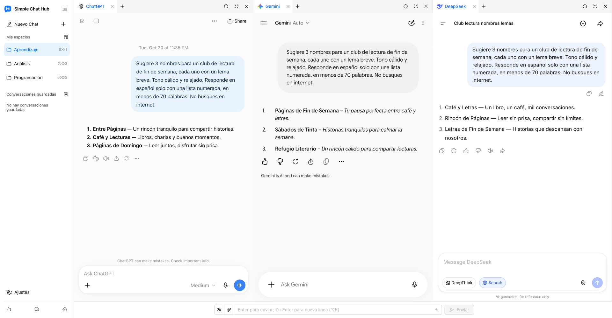

  

# Simple Chat Hub

**Una pregunta. Respuestas de IA en paralelo.**

[Sitio web](https://chathub.aipilot.cc/?lang=es) · [Comentarios](https://chathub.aipilot.cc/feedback?lang=es) · [Historial de cambios](CHANGELOG.md)

[English](README.md) · [简体中文](README_CN.md) · [繁體中文](README_TW.md) · **[Español](README_ES.md)** · [العربية](README_AR.md) · [Русский](README_RU.md) · [Français](README_FR.md) · [Deutsch](README_DE.md) · [Português (Portugal)](README_PT_PT.md) · [Português (Brasil)](README_PT_BR.md) · [日本語](README_JA.md) · [한국어](README_KO.md)

Simple Chat Hub reúne las webs de ChatGPT, Gemini, DeepSeek, Doubao, Kimi y otras plataformas de IA en paralelo en una ventana. Escribe una vez en la entrada común: cada plataforma recibe la pregunta y responde. Sigue conversando con la que quieras explorar más.

Usas las webs de las plataformas con las cuentas en las que ya has iniciado sesión. No necesitas clave API ni registrarte en Simple Chat Hub.

Interfaz real del producto

## Formas de usarlo

- **Entender un concepto.** Pregunta en qué se diferencian correlación y causalidad, compara ejemplos y explicaciones y sigue preguntando en la plataforma que mejor lo explique.
- **Analizar información.** Entrega el mismo informe semanal a varias IA. Compara los puntos clave y las cuestiones por verificar, y contrástalos con el material original.
- **Resolver un problema técnico.** Pregunta por qué una página envía dos veces la misma solicitud API. Compara los enfoques y profundiza en uno.

## Funciones

- **Una pregunta, respuestas en paralelo.** Envía la misma pregunta a todas las plataformas del espacio actual desde la entrada común. Adjunta archivos seleccionándolos, pegándolos o arrastrándolos.
- **Conversaciones independientes.** Cada plataforma conserva su propio contexto. Sigue preguntando en su entrada o utiliza solo una plataforma.
- **Espacios por tarea.** Guarda combinaciones para aprender, analizar o programar. Elige nombres e iconos y cambia con atajos. Usa varias pestañas por columna, ajusta el ancho y pliega la barra lateral.
- **Guarda y retoma conversaciones.** Conserva los enlaces de las conversaciones actuales y su distribución, y vuelve a ellas con un clic.
- **Biblioteca de prompts.** Guarda instrucciones habituales e insértalas con un clic o un atajo. La optimización de prompts ayuda a expresar tus ideas con más claridad.
- **Capturas largas.** Guarda una conversación completa de una plataforma como imagen, con un ancho adecuado para ordenador o móvil.
- **Inicio desde otras herramientas.** Copia un enlace desde el menú del espacio y configúralo en Alfred u otro lanzador. Abre Hub con una pregunta para enviarla automáticamente o solo rellenarla.
- **Más detalles.** Más de 30 plataformas de IA chinas e internacionales integradas, sitios personalizados, atajos configurables, temas claro y oscuro y 12 idiomas de interfaz.

## Instalación

**App de escritorio** · Windows / macOS / Linux

[Descargar app](https://chathub.aipilot.cc/?lang=es#download) · [GitHub Releases](https://github.com/jackyr/simple-chat-hub-extension/releases)

Los instaladores de macOS y Windows aún no están firmados con un certificado de desarrollador, y la versión de macOS tampoco ha sido notarizada por Apple. Al instalar o abrir la aplicación por primera vez, el sistema puede indicar que no puede verificar al desarrollador o al editor. Obtén los instaladores en la página oficial de descargas o en GitHub Releases de este proyecto. En macOS, abre el archivo DMG y mueve la app a Aplicaciones. Si se bloquea al abrirla por primera vez, asegúrate de confiar en el origen de la descarga y abre Ajustes del Sistema → Privacidad y seguridad. Desplázate hasta Seguridad y elige Abrir igualmente; confirma la apertura y autentícate si se solicita.

Instala la extensión desde la tienda oficial de tu navegador:

- [Chrome Web Store](https://chromewebstore.google.com/detail/dpfkgaedamhcmkkgeiajeggihmfjhhlj)
- [Microsoft Edge Add-ons](https://microsoftedge.microsoft.com/addons/detail/simple-chat-hub/plaobjkecadfmaglmhdaolohmckjgnom)
- [Firefox Add-ons](https://addons.mozilla.org/firefox/addon/simple-chat-hub/)

Para instalarla sin conexión, descarga un paquete desde la [lista de archivos del repositorio](https://github.com/jackyr/simple-chat-hub-extension): `.crx.zip` para Chrome / Edge o `.xpi.zip` para Firefox. Descomprime el archivo antes de instalarlo. La instalación manual depende de las restricciones del navegador y del sistema operativo; se recomienda usar las tiendas oficiales.

## Primeros pasos

1. Instala la extensión y haz clic en el icono de Simple Chat Hub de la barra de herramientas del navegador.
2. Inicia sesión en cada plataforma desde su columna. Si no puedes hacerlo allí, inicia sesión en una pestaña nueva del navegador y actualiza la columna.
3. Elige tu combinación de plataformas y guárdala como espacio.
4. Pregunta desde la entrada común, lee las respuestas en paralelo y sigue conversando donde quieras profundizar.

La extensión es gratuita. Cada plataforma establece sus cuentas, suscripciones, límites de uso y requisitos de red. El rellenado y el envío automáticos dependen de la estructura de las webs. Tras un cambio puede ser necesario enviar manualmente durante un tiempo; mantenemos la compatibilidad mediante actualizaciones de configuración. El envío de adjuntos también depende de la plataforma. Algunas, como Grok, no funcionan normalmente en la extensión: usa la aplicación de escritorio o ábrelas en una pestaña nueva.

## Abrir Hub desde Alfred u otro lanzador

1. Sitúa el cursor sobre el espacio deseado en la barra lateral y elige **Copiar enlace de inicio** en su menú.
2. Pega el enlace en la acción de URL del lanzador. Ya incluye la dirección de Hub de tu instalación y las plataformas seleccionadas.
3. Configura el lanzador para sustituir `{query}` por la pregunta, codificada como URL una sola vez, y abrir una **pestaña nueva** en el navegador y perfil donde está instalada la extensión.
4. El enlace copiado incluye `send=1` para enviar la pregunta cuando las plataformas estén listas. Elimina `send=1` para rellenar el campo compartido sin enviarla.

Usa el enlace que hayas copiado: las direcciones de las extensiones varían según el navegador, el perfil y el método de instalación. Consulta las [preguntas frecuentes del sitio web](https://chathub.aipilot.cc/?lang=es#faq) para obtener más ayuda.

## Plataformas

Incluye ChatGPT, Gemini, Claude, DeepSeek, Copilot, Grok, Perplexity, Qwen, Kimi, Doubao, Yuanbao, Mistral, Meta y Z.ai, entre otras plataformas. También puedes añadir sitios personalizados en Configuración.

## Datos y privacidad

Tus datos personales, incluidos espacios, entradas de la biblioteca de prompts y enlaces a conversaciones guardadas, se almacenan localmente. Las preguntas y los archivos adjuntos se envían a las plataformas de IA que elijas.

Usamos Google Analytics para recopilar de forma anónima estadísticas básicas de uso de la interfaz (como clics en botones y atajos de teclado) y de errores, para mejorar el producto.

Al optimizar un prompt, el texto que introduces se envía a los servidores de Simple Chat Hub para su procesamiento. No recopilamos ni almacenamos este texto.

## Comentarios

Informa de problemas o propón mejoras mediante la [página de comentarios](https://chathub.aipilot.cc/feedback?lang=es) o [GitHub Issues](https://github.com/jackyr/simple-chat-hub-extension/issues). Al informar de un error, incluye la plataforma, el navegador, la versión de la extensión y los pasos para reproducirlo.

## Donaciones

Desarrollar y mantener la extensión requiere esfuerzo. Si te gusta o te resulta útil, ¡invítame a un café!

| [Buy Me A Coffee](https://buymeacoffee.com/jackyrao)                                                                          | [PayPal](https://paypal.me/jackyrao)                                                                             | WeChat                                                  |
| ----------------------------------------------------------------------------------------------------------------------------- | ---------------------------------------------------------------------------------------------------------------- | ------------------------------------------------------- |
|  |  |  |

## Donantes

¡Gracias a quienes apoyan el proyecto! Vuestro apoyo ayuda a mantenerlo en marcha.

[Ver la lista de donantes](DONORS.md)
