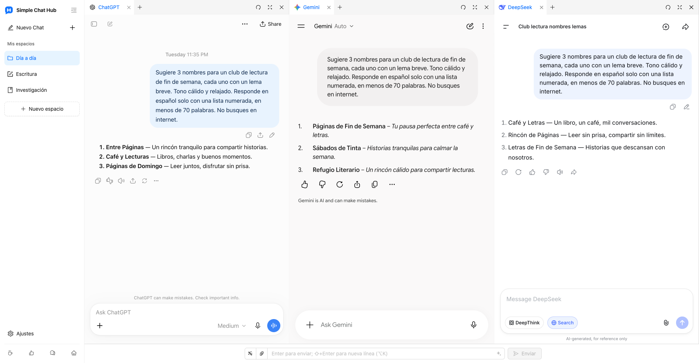

  

# Simple Chat Hub

**Tus IA favoritas, en un mismo lugar.**

[Sitio web](https://chathub.aipilot.cc/?lang=es) · [Comentarios](https://chathub.aipilot.cc/feedback?lang=es) · [Historial de cambios](CHANGELOG.md)

[English](README.md) · [简体中文](README_CN.md) · [繁體中文](README_TW.md) · **[Español](README_ES.md)** · [العربية](README_AR.md) · [Русский](README_RU.md) · [Français](README_FR.md) · [Deutsch](README_DE.md) · [Português (Portugal)](README_PT_PT.md) · [Português (Brasil)](README_PT_BR.md) · [日本語](README_JA.md) · [한국어](README_KO.md)

Simple Chat Hub reúne ChatGPT, Gemini, DeepSeek y otras plataformas de IA en un espacio de trabajo. Conversa en los sitios originales que ya conoces o envía la misma pregunta a varias IA y lee sus respuestas en paralelo para explorar distintos puntos de vista.

Menos buscar dónde empezar, menos cambiar de pestaña. Usar IA cada día, un poco más fácil.

Captura real del producto con el nuevo diseño de espacios y logotipo, y conversaciones reales en ChatGPT, Gemini y DeepSeek.

## Funciones

- **Un mismo lugar. Pregunta a la vez.** Ten a mano tus plataformas habituales. Conversa con cada una por separado o escribe una sola vez para preguntar a varias IA y continuar después cada conversación de forma independiente.
- **Espacios para cada tarea.** Guarda distintas combinaciones de plataformas para escribir, investigar y usar a diario. Personaliza los nombres e iconos de los espacios y organiza las páginas en grupos y pestañas.
- **Más espacio para las respuestas.** Arrastra los bordes para ajustar el ancho de las columnas, cambia el orden de las columnas y pestañas u oculta la barra lateral para leer con más comodidad.
- **Buenos prompts, listos para reutilizar.** Guarda instrucciones útiles en tu biblioteca de prompts y recupéralas cuando las necesites. También puedes optimizar un prompt para expresar mejor una idea.
- **Conversaciones en una sola imagen larga.** Captura una conversación de una plataforma y abre una vista previa local para revisarla, organizarla o compartirla.
- **Menos acciones repetidas.** Configura tus propios atajos de teclado y envía archivos adjuntos desde el campo de entrada compartido en las plataformas compatibles.
- **Abre Hub desde otras herramientas.** Añade el enlace de inicio de un espacio a Alfred u otro lanzador para abrir Hub con una pregunta, lista para editar o enviar automáticamente.
- **Conserva tus cuentas habituales.** Abre los sitios originales de las plataformas de IA, añade sitios personalizados y elige entre temas claro y oscuro y 12 idiomas de interfaz. No necesitas una cuenta de Hub ni una clave API. La extensión es gratuita.

## Instalación

Instala la extensión desde la tienda oficial de tu navegador:

- [Chrome Web Store](https://chromewebstore.google.com/detail/dpfkgaedamhcmkkgeiajeggihmfjhhlj)
- [Microsoft Edge Add-ons](https://microsoftedge.microsoft.com/addons/detail/simple-chat-hub/plaobjkecadfmaglmhdaolohmckjgnom)
- [Firefox Add-ons](https://addons.mozilla.org/firefox/addon/simple-chat-hub/)

Para instalarla sin conexión, descarga un paquete desde la [lista de archivos del repositorio](https://github.com/jackyr/simple-chat-hub-extension): `.crx.zip` para Chrome / Edge o `.xpi.zip` para Firefox. Descomprime el archivo antes de instalarlo. La instalación manual depende de las restricciones del navegador y del sistema operativo; se recomienda usar las tiendas oficiales.

## Primeros pasos

1. Instala la extensión y abre Simple Chat Hub.
2. Elige tus plataformas favoritas y organízalas en espacios.
3. Inicia sesión donde sea necesario y conversa en cada plataforma o usa el campo compartido para preguntar a varias IA a la vez.

Las cuentas, suscripciones, cuotas de uso y requisitos de red dependen de cada plataforma de IA. La integración de páginas, el envío compartido, el envío de archivos y las capturas de conversaciones dependen de la plataforma, del inicio de sesión y de la conexión. Si una plataforma requiere iniciar sesión o completar una verificación, hazlo primero en una pestaña independiente.

## Abrir Hub desde Alfred u otro lanzador

1. Sitúa el cursor sobre el espacio deseado en la barra lateral y elige **Copiar enlace de inicio** en su menú.
2. Pega el enlace en la acción de URL del lanzador. Ya incluye la dirección de Hub de tu instalación y las plataformas seleccionadas.
3. Configura el lanzador para sustituir `{query}` por la pregunta, codificada como URL una sola vez, y abrir una **pestaña nueva** en el navegador y perfil donde está instalada la extensión.
4. El enlace copiado incluye `send=1` para enviar la pregunta cuando las plataformas estén listas. Elimina `send=1` para rellenar el campo compartido sin enviarla.

Usa el enlace que hayas copiado: las direcciones de las extensiones varían según el navegador, el perfil y el método de instalación. Consulta las [preguntas frecuentes del sitio web](https://chathub.aipilot.cc/?lang=es#faq) para obtener más ayuda.

## Plataformas

Incluye ChatGPT, Gemini, Claude, DeepSeek, Copilot, Grok, Perplexity, Qwen, Kimi, Doubao, Yuanbao, Mistral, Meta y Z.ai, entre otras plataformas. También puedes añadir sitios personalizados en Configuración.

## Datos y privacidad

- Los espacios, prompts guardados, atajos y preferencias se guardan en el almacenamiento de extensiones del navegador.
- Las preguntas, archivos adjuntos y conversaciones enviados a las plataformas de IA son tratados por esas plataformas según sus propias políticas.
- Al usar la optimización de prompts, el prompt actual se envía al servicio de optimización de la extensión.
- La extensión solicita información de configuración y versión y envía un identificador de instalación, eventos de uso e información de errores para estadísticas de uso y diagnóstico. Los comentarios y las encuestas envían la información que se presenta.

## Comentarios

Informa de problemas o propón mejoras mediante la [página de comentarios](https://chathub.aipilot.cc/feedback?lang=es) o [GitHub Issues](https://github.com/jackyr/simple-chat-hub-extension/issues). Al informar de un error, incluye la plataforma, el navegador, la versión de la extensión y los pasos para reproducirlo.

## Donaciones

Desarrollar y mantener la extensión requiere esfuerzo. Si te gusta o te resulta útil, ¡invítame a un café!

| [Buy Me A Coffee](https://buymeacoffee.com/jackyrao)                                                                          | [PayPal](https://paypal.me/jackyrao)                                                                             | WeChat                                                  |
| ----------------------------------------------------------------------------------------------------------------------------- | ---------------------------------------------------------------------------------------------------------------- | ------------------------------------------------------- |
|  |  |  |

## Donantes

¡Gracias a quienes apoyan el proyecto! Vuestro apoyo ayuda a mantenerlo en marcha.

[Ver la lista de donantes](DONORS.md)
