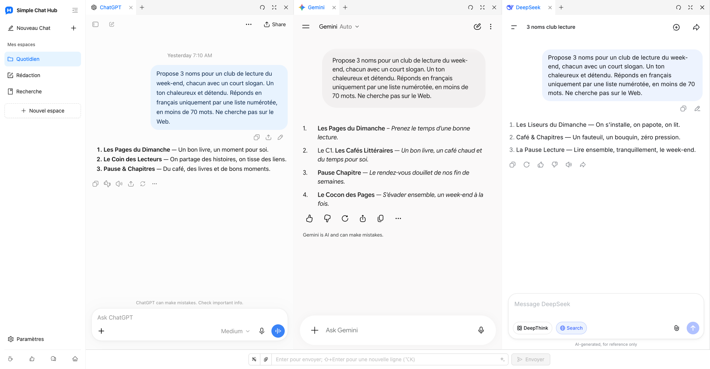

  

# Simple Chat Hub

**Vos IA préférées, au même endroit.**

[Site web](https://chathub.aipilot.cc/?lang=fr) · [Commentaires](https://chathub.aipilot.cc/feedback?lang=fr) · [Historique des versions](CHANGELOG.md)

[English](README.md) · [简体中文](README_CN.md) · [繁體中文](README_TW.md) · [Español](README_ES.md) · [العربية](README_AR.md) · [Русский](README_RU.md) · **[Français](README_FR.md)** · [Deutsch](README_DE.md) · [Português (Portugal)](README_PT_PT.md) · [Português (Brasil)](README_PT_BR.md) · [日本語](README_JA.md) · [한국어](README_KO.md)

Simple Chat Hub réunit ChatGPT, Gemini, DeepSeek et d’autres plateformes d’IA dans un espace de travail. Discutez sur les sites d’origine que vous connaissez déjà, ou envoyez la même question à plusieurs IA et lisez leurs réponses côte à côte pour découvrir différents points de vue.

Moins de recherches pour trouver où commencer, moins de changements d’onglet. L’IA au quotidien, un peu plus simple.

Capture réelle du produit avec la nouvelle disposition des espaces et le nouveau logo, et de véritables conversations sur ChatGPT, Gemini et DeepSeek.

## Fonctionnalités

- **Un seul espace. Posez vos questions ensemble.** Gardez vos plateformes habituelles à portée de main. Discutez avec chacune séparément ou saisissez votre question une seule fois pour interroger plusieurs IA, puis poursuivez chaque conversation individuellement.
- **Des espaces pour vos tâches.** Enregistrez différentes combinaisons de plateformes pour la rédaction, la recherche et le quotidien. Personnalisez les noms et les icônes des espaces et organisez les pages en groupes et en onglets.
- **De la place pour les réponses.** Faites glisser les bordures pour ajuster la largeur des colonnes, réorganisez les colonnes et les onglets ou repliez la barre latérale pour lire plus facilement.
- **De bons prompts, prêts à resservir.** Enregistrez les consignes utiles dans votre bibliothèque de prompts et retrouvez-les au besoin. L’optimisation des prompts peut aussi vous aider à exprimer une idée plus clairement.
- **Vos conversations dans une seule image longue.** Capturez une conversation d’une plateforme, puis ouvrez un aperçu local pour la relire, l’organiser ou la partager.
- **Moins d’actions répétitives.** Personnalisez vos raccourcis clavier et envoyez des pièces jointes depuis le champ de saisie partagé sur les plateformes compatibles.
- **Ouvrez Hub depuis d’autres outils.** Ajoutez le lien de lancement d’un espace à Alfred ou à un autre lanceur pour ouvrir Hub avec une question, prête à être modifiée ou envoyée automatiquement.
- **Conservez vos comptes habituels.** Ouvrez les sites d’origine des plateformes d’IA, ajoutez des sites personnalisés, passez d’un thème clair à un thème sombre et choisissez parmi 12 langues d’interface. Aucun compte Hub ni clé API n’est nécessaire. L’extension est gratuite.

## Installation

Installez l’extension depuis la boutique officielle de votre navigateur :

- [Chrome Web Store](https://chromewebstore.google.com/detail/dpfkgaedamhcmkkgeiajeggihmfjhhlj)
- [Microsoft Edge Add-ons](https://microsoftedge.microsoft.com/addons/detail/simple-chat-hub/plaobjkecadfmaglmhdaolohmckjgnom)
- [Firefox Add-ons](https://addons.mozilla.org/firefox/addon/simple-chat-hub/)

Pour une installation hors ligne, téléchargez un paquet depuis la [liste des fichiers du dépôt](https://github.com/jackyr/simple-chat-hub-extension) : `.crx.zip` pour Chrome / Edge ou `.xpi.zip` pour Firefox. Décompressez l’archive avant l’installation. L’installation manuelle dépend des restrictions du navigateur et du système d’exploitation ; les boutiques officielles sont recommandées.

## Premiers pas

1. Installez l’extension et ouvrez Simple Chat Hub.
2. Choisissez vos plateformes préférées et organisez-les en espaces.
3. Connectez-vous si nécessaire, puis discutez sur chaque plateforme ou utilisez le champ partagé pour interroger plusieurs IA à la fois.

Les comptes, abonnements, quotas d’utilisation et conditions d’accès au réseau dépendent de chaque plateforme d’IA. L’intégration des pages, l’envoi partagé, l’envoi de fichiers et la capture des conversations dépendent de la plateforme, de l’état de connexion et du réseau. Si une plateforme exige une connexion ou une vérification, effectuez-la d’abord dans un onglet séparé.

## Ouvrir Hub depuis Alfred ou un autre lanceur

1. Survolez l’espace souhaité dans la barre latérale et choisissez **Copier le lien de lancement** dans son menu.
2. Collez le lien dans l’action d’ouverture d’URL du lanceur. Il contient déjà l’adresse de Hub propre à votre installation et les plateformes sélectionnées.
3. Configurez le lanceur pour remplacer `{query}` par la question, encodée une seule fois pour une URL, et ouvrir un **nouvel onglet** dans le navigateur et le profil où l’extension est installée.
4. Le lien copié contient `send=1` pour envoyer la question lorsque les plateformes sont prêtes. Supprimez `send=1` pour remplir le champ partagé sans envoyer la question.

Utilisez votre propre lien copié : les adresses des extensions varient selon le navigateur, le profil et la méthode d’installation. Consultez la [FAQ du site web](https://chathub.aipilot.cc/?lang=fr#faq) pour en savoir plus.

## Plateformes

Les plateformes intégrées comprennent notamment ChatGPT, Gemini, Claude, DeepSeek, Copilot, Grok, Perplexity, Qwen, Kimi, Doubao, Yuanbao, Mistral, Meta et Z.ai. Vous pouvez aussi ajouter des sites personnalisés dans les paramètres.

## Données et confidentialité

- Les espaces, prompts enregistrés, raccourcis et préférences sont conservés dans le stockage des extensions du navigateur.
- Les questions, pièces jointes et conversations envoyées aux plateformes d’IA sont traitées par celles-ci selon leurs propres politiques.
- Lorsque vous utilisez l’optimisation des prompts, le prompt actuel est envoyé au service d’optimisation de l’extension.
- L’extension demande des informations de configuration et de version et transmet un identifiant d’installation, des événements d’utilisation et des informations d’erreur à des fins de statistiques et de diagnostic. Les commentaires et questionnaires transmettent les informations soumises.

## Commentaires

Signalez un problème ou proposez une amélioration via la [page de commentaires](https://chathub.aipilot.cc/feedback?lang=fr) ou [GitHub Issues](https://github.com/jackyr/simple-chat-hub-extension/issues). Pour un rapport de bogue, indiquez la plateforme, le navigateur, la version de l’extension et les étapes permettant de reproduire le problème.

## Dons

Le développement et la maintenance demandent du travail. Si cette extension vous plaît ou vous est utile, offrez-moi un café !

| [Buy Me A Coffee](https://buymeacoffee.com/jackyrao)                                                                          | [PayPal](https://paypal.me/jackyrao)                                                                             | WeChat                                                  |
| ----------------------------------------------------------------------------------------------------------------------------- | ---------------------------------------------------------------------------------------------------------------- | ------------------------------------------------------- |
|  |  |  |

## Donateurs

Merci aux personnes qui soutiennent le projet ! Votre soutien contribue à le faire vivre.

[Voir la liste des donateurs](DONORS.md)
