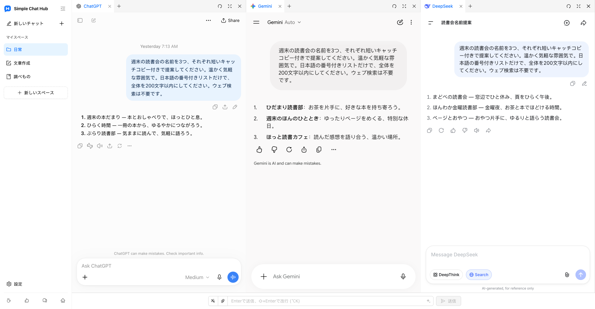

  

# Simple Chat Hub

**いつものAIを、ひとつの場所に。**

[公式サイト](https://chathub.aipilot.cc/?lang=ja) · [フィードバック](https://chathub.aipilot.cc/feedback?lang=ja) · [変更履歴](CHANGELOG.md)

[English](README.md) · [简体中文](README_CN.md) · [繁體中文](README_TW.md) · [Español](README_ES.md) · [العربية](README_AR.md) · [Русский](README_RU.md) · [Français](README_FR.md) · [Deutsch](README_DE.md) · [Português (Portugal)](README_PT_PT.md) · [Português (Brasil)](README_PT_BR.md) · **[日本語](README_JA.md)** · [한국어](README_KO.md)

Simple Chat Hubは、ChatGPT、Gemini、DeepSeekなどのAIサービスをひとつのワークスペースにまとめます。使い慣れた各サービスのページで会話したり、同じ質問を複数のAIへ同時に送り、回答を並べてさまざまな考え方を参考にしたりできます。

開く場所を探す手間も、タブの切り替えも少なく。毎日のAI利用を、もっと手軽に。

新しいスペースレイアウトとロゴを使用した実際の製品画面です。ChatGPT、Gemini、DeepSeekでの実際の会話を表示しています。

## 主な機能

- **ひとつにまとめて、同時に質問。** いつものサービスをすぐ使える場所に。各サービスと個別に会話することも、一度の入力で複数のAIへ質問し、その後はそれぞれの会話を続けることもできます。
- **タスクに合わせたスペース。** 文章作成、調べもの、日常使いなどに合わせてサービスの組み合わせを保存できます。スペースの名前やアイコンを設定し、グループとタブでページを整理できます。
- **回答を読みやすい幅に。** 列の境界をドラッグして幅を調整し、列やタブを並べ替えられます。サイドバーを折りたたんで、回答を広く表示することもできます。
- **よいプロンプトを、次もすぐに。** よく使う指示をプロンプトライブラリに保存し、必要なときに呼び出せます。プロンプトの最適化で、考えをよりわかりやすく伝えることもできます。
- **役立つ会話を、一枚の縦長画像に。** ひとつのサービスの会話を縦長画像として保存し、ローカルでプレビューできます。振り返り、整理、共有に役立ちます。
- **繰り返しの操作を少なく。** キーボードショートカットを自分好みに設定し、対応サービスでは共通入力欄からファイルを添付して送信できます。
- **外部ツールからもすぐに。** スペースの起動リンクをAlfredなどのランチャーに設定すると、質問と一緒にHubを開けます。入力した質問を編集することも、自動送信することもできます。
- **いつものアカウントをそのままに。** AIサービスの元のサイトを開き、カスタムサイトも追加できます。ライト・ダークテーマと12の表示言語に対応しています。Hubのアカウント登録やAPIキーは不要で、拡張機能は無料です。

## インストール

ブラウザーの公式拡張機能ストアからインストールしてください。

- [Chrome Web Store](https://chromewebstore.google.com/detail/dpfkgaedamhcmkkgeiajeggihmfjhhlj)
- [Microsoft Edge Add-ons](https://microsoftedge.microsoft.com/addons/detail/simple-chat-hub/plaobjkecadfmaglmhdaolohmckjgnom)
- [Firefox Add-ons](https://addons.mozilla.org/firefox/addon/simple-chat-hub/)

オフラインでインストールする場合は、[リポジトリのファイル一覧](https://github.com/jackyr/simple-chat-hub-extension)からパッケージをダウンロードしてください。Chrome / Edge用は `.crx.zip`、Firefox用は `.xpi.zip` です。アーカイブを展開してからインストールします。手動インストールにはブラウザーやOSの制限があるため、公式ストアの利用をおすすめします。

## 使い始める

1. 拡張機能をインストールし、Simple Chat Hubを開きます。
2. よく使うサービスを選び、スペースに整理します。
3. 必要なサービスにログインし、各サービスで会話するか、共通入力欄から複数のAIに同時に質問してみてください。

各AIサービスのアカウント、サブスクリプション、利用上限、ネットワーク要件は、それぞれのサービスが定めています。ページの埋め込み、同時送信、ファイル送信、会話のキャプチャが利用できるかは、サービス、ログイン状態、ネットワーク環境によって異なります。ログインや認証が必要な場合は、先に別のタブで完了してください。

## Alfredなどの外部ツールからHubを開く

1. サイドバーの対象スペースにカーソルを合わせ、メニューから**起動リンクをコピー**を選びます。
2. コピーしたリンクをランチャーのURLを開くアクションに貼り付けます。リンクには、自分の環境のHubアドレスと選択したサービスが含まれています。
3. ランチャーで `{query}` を一度だけURLエンコードした質問に置き換え、拡張機能がインストールされているブラウザーとプロファイルの**新しいタブ**で開くように設定します。
4. コピーしたリンクには `send=1` が含まれ、サービスの準備ができると自動送信されます。`send=1` を削除すると、送信せずに共通入力欄へ入力するだけになります。

ブラウザー、プロファイル、インストール方法によって拡張機能のアドレスが異なるため、自分でコピーしたリンクを使ってください。詳しくは[公式サイトのよくある質問](https://chathub.aipilot.cc/?lang=ja#faq)をご覧ください。

## 対応サービス

ChatGPT、Gemini、Claude、DeepSeek、Copilot、Grok、Perplexity、Qwen、Kimi、Doubao、Yuanbao、Mistral、Meta、Z.aiなどを標準で用意しています。設定からカスタムサイトを追加することもできます。

## データとプライバシー

- スペース、保存したプロンプト、ショートカット、各種設定は、ブラウザーの拡張機能ストレージに保存されます。
- AIサービスに送信した質問、添付ファイル、会話は、各サービスのポリシーに従って処理されます。
- プロンプトの最適化を利用すると、現在のプロンプトが拡張機能の最適化サービスに送信されます。
- 拡張機能は設定情報とバージョン情報を取得し、利用統計と問題の診断のためにインストール識別子、利用イベント、エラー情報を送信します。フィードバックやアンケートでは、提出した情報が送信されます。

## フィードバック

不具合の報告や改善の提案は、[フィードバックページ](https://chathub.aipilot.cc/feedback?lang=ja)または[GitHub Issues](https://github.com/jackyr/simple-chat-hub-extension/issues)からお寄せください。不具合を報告する際は、サービス名、ブラウザー、拡張機能のバージョン、再現手順を記載してください。

## 寄付

開発とメンテナンスには時間と労力がかかります。拡張機能を気に入ったり、役に立ったと感じたりしたら、コーヒー一杯分のご支援をいただけるとうれしいです。

| [Buy Me A Coffee](https://buymeacoffee.com/jackyrao)                                                                          | [PayPal](https://paypal.me/jackyrao)                                                                             | WeChat                                                  |
| ----------------------------------------------------------------------------------------------------------------------------- | ---------------------------------------------------------------------------------------------------------------- | ------------------------------------------------------- |
|  |  |  |

## 支援者の皆さま

プロジェクトを支えてくださる皆さま、ありがとうございます。ご支援が開発の継続につながっています。

[支援者一覧を見る](DONORS.md)
