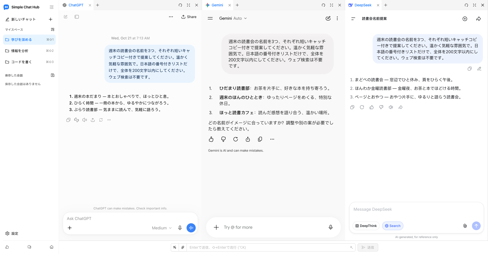

  

# Simple Chat Hub

**一度の質問に、複数のAIが並んで回答。**

[公式サイト](https://chathub.aipilot.cc/?lang=ja) · [フィードバック](https://chathub.aipilot.cc/feedback?lang=ja) · [変更履歴](CHANGELOG.md)

[English](README.md) · [简体中文](README_CN.md) · [繁體中文](README_TW.md) · [Español](README_ES.md) · [العربية](README_AR.md) · [Русский](README_RU.md) · [Français](README_FR.md) · [Deutsch](README_DE.md) · [Português (Portugal)](README_PT_PT.md) · [Português (Brasil)](README_PT_BR.md) · **[日本語](README_JA.md)** · [한국어](README_KO.md)

Simple Chat Hubは、ChatGPT、Gemini、DeepSeek、Doubao、KimiなどのAIサービスのWeb版をひとつのウィンドウに並べます。共通入力欄に一度質問を書けば、各サービスに届いて回答が返ってきます。気になるAIがあれば、そのまま話を深められます。

各サービスのWeb版とログイン済みのアカウントをそのまま利用。APIキーもSimple Chat Hubのアカウント登録も不要です。

実際の製品画面

## こんな使い方ができます

- **概念を理解する。**たとえば「相関関係と因果関係はどう違う？」と聞き、例や説明を比べて、最もわかりやすいサービスで追問します。
- **資料を整理する。**同じチームの週報を複数のAIに渡し、要点や確認すべき点を比較してから、元の資料で確かめます。
- **技術的な問題を調べる。**「同じAPIリクエストが2回送られるのはなぜ？」と聞き、調査方針を比べて、ひとつの方向を掘り下げます。

## 主な機能

- **一度質問して、回答を並べて比較。**共通入力欄から現在のスペース内の全サービスに同じ質問を送信します。ファイルは選択・貼り付け・ドラッグで添付できます。
- **それぞれで会話を続ける。**文脈はサービスごとに独立。各サービスの入力欄で個別に追問したり、ひとつのサービスだけを使ったりできます。
- **用途別のスペース。**学習、資料分析、プログラミングなど、用途ごとにサービスの組み合わせを保存。名前とアイコンを設定し、ショートカットで切り替えられます。1列に複数のタブを置き、列幅を調整したり、サイドバーを閉じたりできます。
- **会話を保存して、いつでも再開。**各サービスの現在の会話リンクと配置を保存し、ワンクリックで元の会話に戻れます。
- **プロンプトライブラリ。**よく使う指示を保存して、クリックやショートカットで挿入。プロンプト最適化で考えをより明確に表現できます。
- **会話の長いスクリーンショット。**ひとつのサービスの会話全体を、PC向け・スマートフォン向けの幅で画像に保存できます。
- **外部ツールから起動。**スペースのメニューで起動リンクをコピーし、Alfredなどのランチャーに設定。質問を入れてHubを開き、自動送信するか、入力だけするかを選べます。
- **その他。**中国を含む世界の30以上のAIサービスに標準対応し、独自のサイトも追加できます。ショートカットのカスタマイズ、ライト・ダークテーマ、12の表示言語に対応しています。

## インストール

**デスクトップアプリ** · Windows / macOS / Linux

[アプリを入手](https://chathub.aipilot.cc/?lang=ja#download) · [GitHub Releases](https://github.com/jackyr/simple-chat-hub-extension/releases)

現在、macOS 版と Windows 版のインストーラーは開発者証明書で署名されておらず、macOS 版は Apple の公証も受けていません。初回のインストールや起動時に、開発元や発行元を確認できないというメッセージが表示されることがあります。インストーラーは公式ダウンロードページ、または本プロジェクトの GitHub Releases から入手してください。 macOS では DMG を開き、アプリを「アプリケーション」に移動してください。初回起動がブロックされた場合は、ダウンロード元が信頼できることを確認し、「システム設定 → プライバシーとセキュリティ」の「セキュリティ」までスクロールして「このまま開く」を選択します。表示に従って開くことを確認し、必要に応じて認証してください。

ブラウザーの公式拡張機能ストアからインストールしてください。

- [Chrome Web Store](https://chromewebstore.google.com/detail/dpfkgaedamhcmkkgeiajeggihmfjhhlj)
- [Microsoft Edge Add-ons](https://microsoftedge.microsoft.com/addons/detail/simple-chat-hub/plaobjkecadfmaglmhdaolohmckjgnom)
- [Firefox Add-ons](https://addons.mozilla.org/firefox/addon/simple-chat-hub/)

オフラインでインストールする場合は、[リポジトリのファイル一覧](https://github.com/jackyr/simple-chat-hub-extension)からパッケージをダウンロードしてください。Chrome / Edge用は `.crx.zip`、Firefox用は `.xpi.zip` です。アーカイブを展開してからインストールします。手動インストールにはブラウザーやOSの制限があるため、公式ストアの利用をおすすめします。

## 使い始める

1. 拡張機能をインストールし、ブラウザーのツールバーにあるSimple Chat Hubのアイコンをクリックします。
2. 各列で使いたいサービスにログインします。列内でログインできない場合は、新しいブラウザータブでログインしてから、その列を再読み込みしてください。
3. サービスの組み合わせを選び、自分のスペースとして保存します。
4. 共通入力欄で質問し、回答を並べて読み、気になるサービスで追問します。

拡張機能は無料です。アカウント、サブスクリプション、利用上限、ネットワーク要件は各サービスが定めます。自動入力・送信は各Webサイトの構造に依存します。サイトの変更により一時的に手動送信が必要になる場合がありますが、設定更新で継続的に対応します。添付ファイルを送信できるかどうかも各サービスに依存します。Grokなど一部のサービスは拡張機能では正常に利用できないため、デスクトップアプリまたは新しいタブをご利用ください。

## Alfredなどの外部ツールからHubを開く

1. サイドバーの対象スペースにカーソルを合わせ、メニューから**起動リンクをコピー**を選びます。
2. コピーしたリンクをランチャーのURLを開くアクションに貼り付けます。リンクには、自分の環境のHubアドレスと選択したサービスが含まれています。
3. ランチャーで `{query}` を一度だけURLエンコードした質問に置き換え、拡張機能がインストールされているブラウザーとプロファイルの**新しいタブ**で開くように設定します。
4. コピーしたリンクには `send=1` が含まれ、サービスの準備ができると自動送信されます。`send=1` を削除すると、送信せずに共通入力欄へ入力するだけになります。

ブラウザー、プロファイル、インストール方法によって拡張機能のアドレスが異なるため、自分でコピーしたリンクを使ってください。詳しくは[公式サイトのよくある質問](https://chathub.aipilot.cc/?lang=ja#faq)をご覧ください。

## 対応サービス

ChatGPT、Gemini、Claude、DeepSeek、Copilot、Grok、Perplexity、Qwen、Kimi、Doubao、Yuanbao、Mistral、Meta、Z.aiなどを標準で用意しています。設定からカスタムサイトを追加することもできます。

## データとプライバシー

スペース、プロンプトライブラリ、保存済み会話のリンクなどの個人データは、すべてローカルに保存されます。質問と添付ファイルは、選択した AI プラットフォームに送信されます。

製品の改善のため、Google Analytics を通じて、ボタンのクリックやキーボードショートカットなどの基本的な画面の利用統計とエラー統計を匿名で収集します。

プロンプトの最適化を使うと、入力したテキストが処理のため Simple Chat Hub のサーバーに送信されます。このテキストを収集・保存することはありません。

## フィードバック

不具合の報告や改善の提案は、[フィードバックページ](https://chathub.aipilot.cc/feedback?lang=ja)または[GitHub Issues](https://github.com/jackyr/simple-chat-hub-extension/issues)からお寄せください。不具合を報告する際は、サービス名、ブラウザー、拡張機能のバージョン、再現手順を記載してください。

## 寄付

開発とメンテナンスには時間と労力がかかります。拡張機能を気に入ったり、役に立ったと感じたりしたら、コーヒー一杯分のご支援をいただけるとうれしいです。

| [Buy Me A Coffee](https://buymeacoffee.com/jackyrao)                                                                          | [PayPal](https://paypal.me/jackyrao)                                                                             | WeChat                                                  |
| ----------------------------------------------------------------------------------------------------------------------------- | ---------------------------------------------------------------------------------------------------------------- | ------------------------------------------------------- |
|  |  |  |

## 支援者の皆さま

プロジェクトを支えてくださる皆さま、ありがとうございます。ご支援が開発の継続につながっています。

[支援者一覧を見る](DONORS.md)
