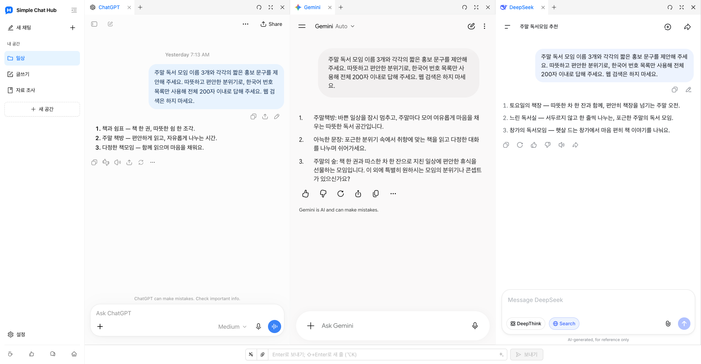

  

# Simple Chat Hub

**자주 쓰는 AI를 한곳에서, 더 편하게.**

[공식 사이트](https://chathub.aipilot.cc/?lang=ko) · [피드백](https://chathub.aipilot.cc/feedback?lang=ko) · [변경 내역](CHANGELOG.md)

[English](README.md) · [简体中文](README_CN.md) · [繁體中文](README_TW.md) · [Español](README_ES.md) · [العربية](README_AR.md) · [Русский](README_RU.md) · [Français](README_FR.md) · [Deutsch](README_DE.md) · [Português (Portugal)](README_PT_PT.md) · [Português (Brasil)](README_PT_BR.md) · [日本語](README_JA.md) · **[한국어](README_KO.md)**

Simple Chat Hub는 ChatGPT, Gemini, DeepSeek 같은 AI 플랫폼을 하나의 작업 공간에 모아 줍니다. 익숙한 원래 플랫폼 페이지에서 대화하거나, 같은 질문을 여러 AI에 동시에 보내 답변을 나란히 읽으며 다양한 생각을 참고할 수 있습니다.

접속할 곳을 찾는 시간도, 탭을 오가는 번거로움도 줄이세요. 매일 쓰는 AI가 조금 더 편해집니다.

새 공간 레이아웃과 로고를 적용한 실제 제품 화면입니다. ChatGPT, Gemini, DeepSeek에서 진행한 실제 대화를 보여 줍니다.

## 주요 기능

- **한곳에 모아, 동시에 질문하세요.** 자주 쓰는 플랫폼을 가까이 두세요. 각각 따로 대화하거나 한 번 입력해 여러 AI에 질문한 뒤, 각 플랫폼에서 개별적으로 대화를 이어갈 수 있습니다.
- **작업에 맞게 정리하는 공간.** 글쓰기, 자료 조사, 일상적인 용도에 맞춰 플랫폼 조합을 저장하세요. 공간 이름과 아이콘을 지정하고 그룹과 탭으로 페이지를 정리할 수 있습니다.
- **답변을 읽기 편한 너비로.** 열 경계를 드래그해 너비를 조절하고 열과 탭 순서를 바꾸세요. 사이드바를 접어 답변을 더 넓게 볼 수도 있습니다.
- **좋은 프롬프트는 다음에도 바로.** 자주 쓰는 지시문을 프롬프트 라이브러리에 저장하고 필요할 때 불러오세요. 프롬프트 최적화로 생각을 더 명확하게 표현할 수도 있습니다.
- **유용한 대화를 긴 이미지 한 장으로.** 한 플랫폼의 대화를 긴 이미지로 저장하고 로컬 미리보기를 열어 다시 읽거나 정리하고 공유할 수 있습니다.
- **반복 작업은 더 적게.** 원하는 키보드 단축키를 설정하고 호환되는 플랫폼에서는 공통 입력창으로 첨부 파일을 보낼 수 있습니다.
- **외부 도구에서도 바로 열기.** 공간 실행 링크를 Alfred 같은 실행 도구에 등록하면 질문과 함께 Hub를 열 수 있습니다. 질문을 더 편집하거나 자동으로 보내도록 설정할 수 있습니다.
- **익숙한 계정 그대로.** 각 AI 플랫폼의 원래 사이트를 열고 사용자 지정 사이트를 추가하세요. 밝은 테마와 어두운 테마, 12개 인터페이스 언어를 지원합니다. Hub 계정 가입이나 API 키가 필요 없으며 확장 프로그램은 무료입니다.

## 설치

브라우저의 공식 확장 프로그램 스토어에서 설치하세요.

- [Chrome Web Store](https://chromewebstore.google.com/detail/dpfkgaedamhcmkkgeiajeggihmfjhhlj)
- [Microsoft Edge Add-ons](https://microsoftedge.microsoft.com/addons/detail/simple-chat-hub/plaobjkecadfmaglmhdaolohmckjgnom)
- [Firefox Add-ons](https://addons.mozilla.org/firefox/addon/simple-chat-hub/)

오프라인으로 설치하려면 [저장소 파일 목록](https://github.com/jackyr/simple-chat-hub-extension)에서 패키지를 다운로드하세요. Chrome / Edge는 `.crx.zip`, Firefox는 `.xpi.zip`을 사용합니다. 압축을 푼 뒤 설치하세요. 수동 설치는 브라우저와 운영체제의 제한을 받으므로 공식 스토어 이용을 권장합니다.

## 시작하기

1. 확장 프로그램을 설치하고 Simple Chat Hub를 여세요.
2. 자주 쓰는 플랫폼을 선택하고 공간으로 정리하세요.
3. 필요한 플랫폼에 로그인한 뒤 각각 대화하거나 공통 입력창으로 여러 AI에 동시에 질문해 보세요.

각 AI 플랫폼의 계정, 구독, 사용 한도, 네트워크 요구 사항은 해당 플랫폼에서 정합니다. 페이지 삽입, 동시 전송, 파일 전송, 대화 캡처의 지원 여부는 플랫폼, 로그인 상태, 네트워크 환경에 따라 달라집니다. 로그인이나 인증이 필요하면 먼저 별도 탭에서 완료하세요.

## Alfred 같은 외부 도구에서 Hub 열기

1. 사이드바에서 원하는 공간에 마우스를 올리고 메뉴에서 **실행 링크 복사**를 선택하세요.
2. 복사한 링크를 실행 도구의 URL 열기 작업에 붙여 넣으세요. 링크에는 현재 설치 환경의 Hub 주소와 선택한 플랫폼이 이미 포함되어 있습니다.
3. 실행 도구가 `{query}`를 한 번만 URL 인코딩한 질문으로 바꾸고, 확장 프로그램이 설치된 브라우저와 프로필에서 **새 탭**을 열도록 설정하세요.
4. 복사한 링크에는 `send=1`이 포함되어 플랫폼이 준비되면 자동으로 전송합니다. `send=1`을 삭제하면 전송하지 않고 공통 입력창에 질문만 채웁니다.

브라우저, 프로필, 설치 방식에 따라 확장 프로그램 주소가 달라지므로 직접 복사한 링크를 사용하세요. 자세한 내용은 [공식 사이트의 자주 묻는 질문](https://chathub.aipilot.cc/?lang=ko#faq)에서 확인할 수 있습니다.

## 지원 플랫폼

ChatGPT, Gemini, Claude, DeepSeek, Copilot, Grok, Perplexity, Qwen, Kimi, Doubao, Yuanbao, Mistral, Meta, Z.ai 등을 기본으로 제공합니다. 설정에서 사용자 지정 사이트를 추가할 수도 있습니다.

## 데이터 및 개인정보

- 공간, 저장한 프롬프트, 단축키, 환경설정은 브라우저 확장 프로그램 저장소에 보관됩니다.
- AI 플랫폼으로 보낸 질문, 첨부 파일, 대화는 해당 플랫폼의 정책에 따라 처리됩니다.
- 프롬프트 최적화를 사용하면 현재 프롬프트가 확장 프로그램의 최적화 서비스로 전송됩니다.
- 확장 프로그램은 구성 및 버전 정보를 요청하고, 사용 통계와 문제 진단을 위해 설치 식별자, 사용 이벤트, 오류 정보를 전송합니다. 피드백과 설문에서는 제출한 정보가 전송됩니다.

## 피드백

문제 신고나 개선 제안은 [피드백 페이지](https://chathub.aipilot.cc/feedback?lang=ko) 또는 [GitHub Issues](https://github.com/jackyr/simple-chat-hub-extension/issues)로 보내 주세요. 오류를 신고할 때는 플랫폼, 브라우저, 확장 프로그램 버전, 재현 단계를 함께 알려 주세요.

## 후원

개발과 유지 관리에는 시간과 노력이 필요합니다. 확장 프로그램이 마음에 들거나 도움이 되었다면 커피 한 잔으로 응원해 주세요!

| [Buy Me A Coffee](https://buymeacoffee.com/jackyrao)                                                                          | [PayPal](https://paypal.me/jackyrao)                                                                             | WeChat                                                  |
| ----------------------------------------------------------------------------------------------------------------------------- | ---------------------------------------------------------------------------------------------------------------- | ------------------------------------------------------- |
|  |  |  |

## 후원자

프로젝트를 후원해 주시는 모든 분께 감사드립니다. 여러분의 지원이 꾸준한 개발에 도움이 됩니다.

[후원자 목록 보기](DONORS.md)
