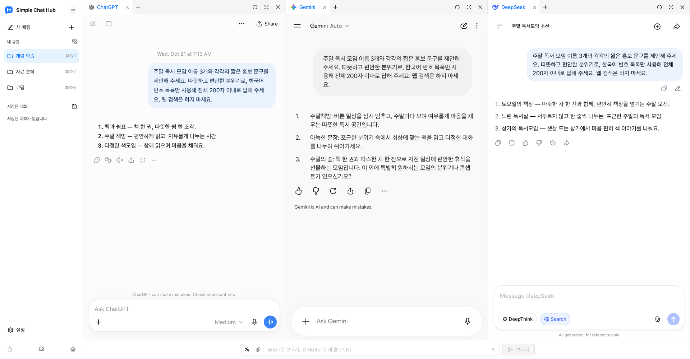

  

# Simple Chat Hub

**한 번 질문하고, 여러 AI 답변을 나란히.**

[공식 사이트](https://chathub.aipilot.cc/?lang=ko) · [피드백](https://chathub.aipilot.cc/feedback?lang=ko) · [변경 내역](CHANGELOG.md)

[English](README.md) · [简体中文](README_CN.md) · [繁體中文](README_TW.md) · [Español](README_ES.md) · [العربية](README_AR.md) · [Русский](README_RU.md) · [Français](README_FR.md) · [Deutsch](README_DE.md) · [Português (Portugal)](README_PT_PT.md) · [Português (Brasil)](README_PT_BR.md) · [日本語](README_JA.md) · **[한국어](README_KO.md)**

Simple Chat Hub는 ChatGPT, Gemini, DeepSeek, Doubao, Kimi 등 AI 플랫폼의 웹사이트를 한 창에 나란히 보여 줍니다. 공통 입력창에 질문을 한 번 쓰면 각 플랫폼이 동시에 받고 답합니다. 더 알아보고 싶은 AI에서 대화를 이어 가세요.

각 플랫폼의 웹사이트와 로그인한 기존 계정을 그대로 사용합니다. API 키도, Simple Chat Hub 계정 가입도 필요 없습니다.

실제 제품 화면

## 이렇게 활용해 보세요

- **개념 이해하기.** ‘상관관계와 인과관계는 어떻게 다른가요?’라고 물어 예시와 설명을 비교하고 가장 이해하기 쉬운 플랫폼에 후속 질문을 하세요.
- **자료 정리하기.** 같은 팀 주간 보고서를 여러 AI에 전달하고 각자가 뽑은 핵심과 확인할 사항을 비교한 뒤 원자료를 확인하세요.
- **기술 문제 해결하기.** ‘페이지가 같은 API 요청을 두 번 보내는 이유는 무엇인가요?’라고 물어 해결 방향을 비교하고 하나를 깊이 살펴보세요.

## 주요 기능

- **한 번 질문하고 나란히 비교.** 공통 입력창에서 현재 공간의 모든 플랫폼에 같은 질문을 보내고 답변을 나란히 읽으세요. 파일은 선택, 붙여넣기, 끌어 놓기로 첨부할 수 있습니다.
- **각자 이어서 대화.** 각 플랫폼이 대화 맥락을 따로 유지합니다. 플랫폼의 입력창에서 개별 후속 질문을 하거나 한 플랫폼만 사용할 수도 있습니다.
- **작업별 공간.** 학습, 자료 분석, 코딩에 맞는 플랫폼 조합을 저장하세요. 이름과 아이콘을 정하고 단축키로 전환할 수 있습니다. 한 열에 여러 탭을 두고 열 너비를 조절하거나 사이드바를 접을 수 있습니다.
- **대화 저장과 다시 열기.** 각 플랫폼의 현재 대화 링크와 배치를 저장해 클릭 한 번으로 돌아가세요.
- **프롬프트 라이브러리.** 자주 쓰는 지시를 저장하고 클릭이나 단축키로 입력하세요. 프롬프트 최적화로 생각을 더 명확히 표현할 수도 있습니다.
- **긴 대화 캡처.** 한 플랫폼의 전체 대화를 컴퓨터나 모바일에서 읽기 좋은 너비의 긴 이미지로 저장하세요.
- **외부 도구에서 열기.** 공간 메뉴의 실행 링크를 Alfred 같은 런처에 설정하세요. 질문과 함께 Hub를 열어 자동 전송하거나 입력만 할 수 있습니다.
- **더 다양한 기능.** 중국 및 전 세계 AI 플랫폼 30개 이상을 기본 지원하며 사용자 지정 사이트도 추가할 수 있습니다. 단축키 설정, 밝은 테마와 어두운 테마, 12개 인터페이스 언어를 지원합니다.

## 설치

**데스크톱 앱** · Windows / macOS / Linux

[앱 다운로드](https://chathub.aipilot.cc/?lang=ko#download) · [GitHub Releases](https://github.com/jackyr/simple-chat-hub-extension/releases)

현재 macOS 및 Windows 설치 파일은 개발자 인증서로 서명되어 있지 않으며, macOS 버전은 Apple의 공증도 받지 않았습니다. 처음 설치하거나 실행할 때 시스템에서 개발자 또는 게시자를 확인할 수 없다는 메시지가 표시될 수 있습니다. 설치 파일은 공식 다운로드 페이지 또는 이 프로젝트의 GitHub Releases에서 받으세요. macOS에서는 DMG를 열고 앱을 응용 프로그램 폴더로 옮기세요. 처음 실행할 때 차단되면 다운로드 출처를 신뢰할 수 있는지 확인한 후 시스템 설정 → 개인정보 보호 및 보안에서 보안 항목으로 스크롤하여 ‘확인 없이 열기’를 선택하세요. 다시 열기를 확인하고 요청되면 인증하세요.

브라우저의 공식 확장 프로그램 스토어에서 설치하세요.

- [Chrome Web Store](https://chromewebstore.google.com/detail/dpfkgaedamhcmkkgeiajeggihmfjhhlj)
- [Microsoft Edge Add-ons](https://microsoftedge.microsoft.com/addons/detail/simple-chat-hub/plaobjkecadfmaglmhdaolohmckjgnom)
- [Firefox Add-ons](https://addons.mozilla.org/firefox/addon/simple-chat-hub/)

오프라인으로 설치하려면 [저장소 파일 목록](https://github.com/jackyr/simple-chat-hub-extension)에서 패키지를 다운로드하세요. Chrome / Edge는 `.crx.zip`, Firefox는 `.xpi.zip`을 사용합니다. 압축을 푼 뒤 설치하세요. 수동 설치는 브라우저와 운영체제의 제한을 받으므로 공식 스토어 이용을 권장합니다.

## 시작하기

1. 확장 프로그램을 설치하고 브라우저 도구 모음의 Simple Chat Hub 아이콘을 클릭하세요.
2. 각 열에서 필요한 플랫폼에 로그인하세요. 열 안에서 로그인할 수 없다면 새 브라우저 탭에서 로그인한 뒤 해당 열을 새로고침하세요.
3. 플랫폼 조합을 골라 내 공간으로 저장하세요.
4. 공통 입력창에서 질문하고 답변을 나란히 읽은 뒤 원하는 플랫폼에서 대화를 이어 가세요.

확장 프로그램은 무료입니다. 계정, 구독, 사용 한도, 네트워크 요건은 각 플랫폼에서 정합니다. 자동 입력과 전송은 웹사이트 구조에 의존하므로 사이트 변경 후 일시적으로 수동 전송이 필요할 수 있습니다. 설정 업데이트로 지속적으로 대응합니다. 첨부 파일 전송 여부도 플랫폼에 따라 다릅니다. Grok 등 일부 플랫폼은 확장 프로그램에서 정상적으로 이용할 수 없으므로 데스크톱 앱이나 새 탭을 사용하세요.

## Alfred 같은 외부 도구에서 Hub 열기

1. 사이드바에서 원하는 공간에 마우스를 올리고 메뉴에서 **실행 링크 복사**를 선택하세요.
2. 복사한 링크를 실행 도구의 URL 열기 작업에 붙여 넣으세요. 링크에는 현재 설치 환경의 Hub 주소와 선택한 플랫폼이 이미 포함되어 있습니다.
3. 실행 도구가 `{query}`를 한 번만 URL 인코딩한 질문으로 바꾸고, 확장 프로그램이 설치된 브라우저와 프로필에서 **새 탭**을 열도록 설정하세요.
4. 복사한 링크에는 `send=1`이 포함되어 플랫폼이 준비되면 자동으로 전송합니다. `send=1`을 삭제하면 전송하지 않고 공통 입력창에 질문만 채웁니다.

브라우저, 프로필, 설치 방식에 따라 확장 프로그램 주소가 달라지므로 직접 복사한 링크를 사용하세요. 자세한 내용은 [공식 사이트의 자주 묻는 질문](https://chathub.aipilot.cc/?lang=ko#faq)에서 확인할 수 있습니다.

## 지원 플랫폼

ChatGPT, Gemini, Claude, DeepSeek, Copilot, Grok, Perplexity, Qwen, Kimi, Doubao, Yuanbao, Mistral, Meta, Z.ai 등을 기본으로 제공합니다. 설정에서 사용자 지정 사이트를 추가할 수도 있습니다.

## 데이터 및 개인정보 안내

스페이스, 프롬프트 라이브러리, 저장된 대화 링크 등 개인 데이터는 모두 로컬에 저장됩니다. 질문과 첨부 파일은 선택한 AI 플랫폼으로 전송됩니다.

제품 개선을 위해 Google Analytics를 통해 버튼 클릭, 키보드 단축키 등 기본적인 인터페이스 사용 통계와 오류 통계를 익명으로 수집합니다.

프롬프트 최적화를 사용하면 입력한 텍스트가 처리를 위해 Simple Chat Hub 서버로 전송됩니다. 이 텍스트를 수집하거나 저장하지 않습니다.

## 피드백

문제 신고나 개선 제안은 [피드백 페이지](https://chathub.aipilot.cc/feedback?lang=ko) 또는 [GitHub Issues](https://github.com/jackyr/simple-chat-hub-extension/issues)로 보내 주세요. 오류를 신고할 때는 플랫폼, 브라우저, 확장 프로그램 버전, 재현 단계를 함께 알려 주세요.

## 후원

개발과 유지 관리에는 시간과 노력이 필요합니다. 확장 프로그램이 마음에 들거나 도움이 되었다면 커피 한 잔으로 응원해 주세요!

| [Buy Me A Coffee](https://buymeacoffee.com/jackyrao)                                                                          | [PayPal](https://paypal.me/jackyrao)                                                                             | WeChat                                                  |
| ----------------------------------------------------------------------------------------------------------------------------- | ---------------------------------------------------------------------------------------------------------------- | ------------------------------------------------------- |
|  |  |  |

## 후원자

프로젝트를 후원해 주시는 모든 분께 감사드립니다. 여러분의 지원이 꾸준한 개발에 도움이 됩니다.

[후원자 목록 보기](DONORS.md)
