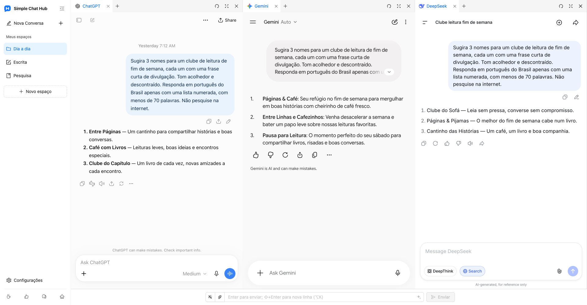

  

# Simple Chat Hub

**Suas IAs favoritas, no mesmo lugar.**

[Site](https://chathub.aipilot.cc/?lang=pt-BR) · [Feedback](https://chathub.aipilot.cc/feedback?lang=pt-BR) · [Histórico de alterações](CHANGELOG.md)

[English](README.md) · [简体中文](README_CN.md) · [繁體中文](README_TW.md) · [Español](README_ES.md) · [العربية](README_AR.md) · [Русский](README_RU.md) · [Français](README_FR.md) · [Deutsch](README_DE.md) · [Português (Portugal)](README_PT_PT.md) · **[Português (Brasil)](README_PT_BR.md)** · [日本語](README_JA.md) · [한국어](README_KO.md)

O Simple Chat Hub reúne ChatGPT, Gemini, DeepSeek e outras plataformas de IA em um espaço de trabalho. Converse nos sites originais que você já conhece ou envie a mesma pergunta a várias IAs e leia as respostas lado a lado para explorar diferentes perspectivas.

Menos procurar por onde começar, menos trocar de aba. Usar IA no dia a dia fica um pouco mais simples.

Captura real do produto com o novo layout de espaços e logo, e conversas reais no ChatGPT, Gemini e DeepSeek.

## Recursos

- **Um só lugar. Pergunte de uma vez.** Mantenha suas plataformas favoritas por perto. Converse com cada uma separadamente ou digite uma única vez para perguntar a várias IAs e depois continuar cada conversa de forma independente.
- **Espaços para suas tarefas.** Salve diferentes combinações de plataformas para escrita, pesquisa e uso diário. Personalize os nomes e ícones dos espaços e organize as páginas em grupos e abas.
- **Mais espaço para as respostas.** Arraste as bordas para ajustar a largura das colunas, reorganize colunas e abas ou recolha a barra lateral para facilitar a leitura.
- **Bons prompts, prontos para usar de novo.** Salve instruções úteis na biblioteca de prompts e acesse-as quando precisar. A otimização de prompts também pode ajudar você a expressar uma ideia com mais clareza.
- **Conversas salvas em uma única imagem longa.** Capture uma conversa de uma plataforma e abra uma prévia local para rever, organizar ou compartilhar.
- **Menos ações repetidas.** Configure seus próprios atalhos de teclado e envie arquivos anexos pelo campo de entrada compartilhado nas plataformas compatíveis.
- **Abra por outras ferramentas.** Adicione o link de abertura de um espaço ao Alfred ou a outro inicializador para abrir o Hub com uma pergunta, pronta para editar ou enviar automaticamente.
- **Continue com suas contas habituais.** Abra os sites originais das plataformas de IA, adicione sites personalizados e escolha entre temas claro e escuro e 12 idiomas de interface. Não é preciso criar uma conta no Hub nem fornecer uma chave API. A extensão é gratuita.

## Instalação

Instale a extensão pela loja oficial do seu navegador:

- [Chrome Web Store](https://chromewebstore.google.com/detail/dpfkgaedamhcmkkgeiajeggihmfjhhlj)
- [Microsoft Edge Add-ons](https://microsoftedge.microsoft.com/addons/detail/simple-chat-hub/plaobjkecadfmaglmhdaolohmckjgnom)
- [Firefox Add-ons](https://addons.mozilla.org/firefox/addon/simple-chat-hub/)

Para instalar offline, baixe um pacote da [lista de arquivos do repositório](https://github.com/jackyr/simple-chat-hub-extension): `.crx.zip` para Chrome / Edge ou `.xpi.zip` para Firefox. Extraia o arquivo antes de instalar. A instalação manual está sujeita às restrições do navegador e do sistema operacional; recomendamos as lojas oficiais.

## Primeiros passos

1. Instale a extensão e abra o Simple Chat Hub.
2. Escolha suas plataformas favoritas e organize-as em espaços.
3. Faça login quando necessário e converse em cada plataforma ou use o campo compartilhado para perguntar a várias IAs de uma vez.

As contas, assinaturas, limites de uso e requisitos de rede são definidos por cada plataforma de IA. A incorporação de páginas, o envio compartilhado, o envio de arquivos e as capturas de conversas dependem da plataforma, do estado do login e da conexão. Se uma plataforma exigir login ou verificação, conclua essa etapa primeiro em uma aba separada.

## Abrir o Hub pelo Alfred ou outro inicializador

1. Passe o cursor sobre o espaço desejado na barra lateral e escolha **Copiar link de abertura** no menu.
2. Cole o link na ação de URL do inicializador. Ele já inclui o endereço do Hub da sua instalação e as plataformas selecionadas.
3. Configure o inicializador para substituir `{query}` pela pergunta, codificada para URL uma única vez, e abrir uma **nova aba** no navegador e perfil em que a extensão está instalada.
4. O link copiado inclui `send=1` para enviar a pergunta quando as plataformas estiverem prontas. Remova `send=1` para preencher o campo compartilhado sem enviar.

Use o link que você copiou: os endereços das extensões variam entre navegadores, perfis e formas de instalação. Consulte as [perguntas frequentes do site](https://chathub.aipilot.cc/?lang=pt-BR#faq) para saber mais.

## Plataformas

As plataformas integradas incluem ChatGPT, Gemini, Claude, DeepSeek, Copilot, Grok, Perplexity, Qwen, Kimi, Doubao, Yuanbao, Mistral, Meta e Z.ai, entre outras. Você também pode adicionar sites personalizados nas configurações.

## Dados e privacidade

- Os espaços, prompts salvos, atalhos e preferências ficam no armazenamento de extensões do navegador.
- As perguntas, os anexos e as conversas enviados às plataformas de IA são tratados por essas plataformas conforme suas próprias políticas.
- Ao usar a otimização de prompts, o prompt atual é enviado ao serviço de otimização da extensão.
- A extensão solicita informações de configuração e versão e envia um identificador de instalação, eventos de uso e informações de erros para estatísticas de uso e diagnóstico. O feedback e as pesquisas enviam as informações submetidas.

## Feedback

Relate um problema ou sugira uma melhoria pela [página de feedback](https://chathub.aipilot.cc/feedback?lang=pt-BR) ou pelo [GitHub Issues](https://github.com/jackyr/simple-chat-hub-extension/issues). Ao relatar um erro, informe a plataforma, o navegador, a versão da extensão e os passos para reproduzi-lo.

## Doações

Desenvolver e manter a extensão exige tempo e esforço. Se você gosta dela ou a considera útil, me pague um café!

| [Buy Me A Coffee](https://buymeacoffee.com/jackyrao)                                                                          | [PayPal](https://paypal.me/jackyrao)                                                                             | WeChat                                                  |
| ----------------------------------------------------------------------------------------------------------------------------- | ---------------------------------------------------------------------------------------------------------------- | ------------------------------------------------------- |
|  |  |  |

## Apoiadores

Obrigado a quem apoia o projeto! Seu apoio ajuda a manter o desenvolvimento.

[Ver a lista de apoiadores](DONORS.md)
