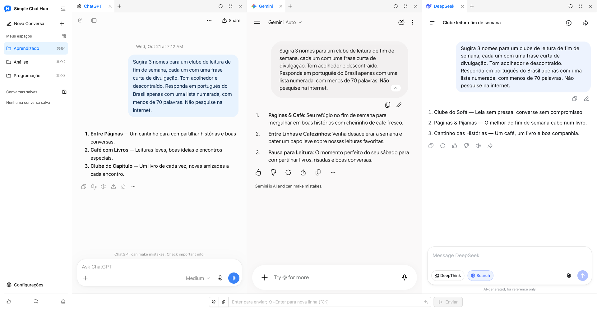

  

# Simple Chat Hub

**Uma pergunta. Respostas de IA lado a lado.**

[Site](https://chathub.aipilot.cc/?lang=pt-BR) · [Feedback](https://chathub.aipilot.cc/feedback?lang=pt-BR) · [Histórico de alterações](CHANGELOG.md)

[English](README.md) · [简体中文](README_CN.md) · [繁體中文](README_TW.md) · [Español](README_ES.md) · [العربية](README_AR.md) · [Русский](README_RU.md) · [Français](README_FR.md) · [Deutsch](README_DE.md) · [Português (Portugal)](README_PT_PT.md) · **[Português (Brasil)](README_PT_BR.md)** · [日本語](README_JA.md) · [한국어](README_KO.md)

O Simple Chat Hub reúne os sites do ChatGPT, Gemini, DeepSeek, Doubao, Kimi e de outras plataformas de IA lado a lado em uma janela. Escreva uma vez no campo comum: cada plataforma recebe a pergunta e responde. Continue a conversa naquela em que quiser se aprofundar.

Você usa os sites das plataformas com suas contas já conectadas. Não precisa de chave API nem de criar uma conta no Simple Chat Hub.

Interface real do produto

## Formas de usar

- **Entender um conceito.** Pergunte a diferença entre correlação e causalidade, compare exemplos e explicações e continue na plataforma que explicar melhor.
- **Analisar informações.** Entregue o mesmo relatório semanal a várias IAs. Compare os pontos principais e as questões a verificar e confira os documentos originais.
- **Investigar um problema técnico.** Pergunte por que uma página envia duas vezes a mesma solicitação API. Compare as abordagens e aprofunde uma delas.

## Recursos

- **Uma pergunta, respostas lado a lado.** Envie a mesma pergunta a todas as plataformas do espaço atual pelo campo comum. Anexe arquivos selecionando, colando ou arrastando.
- **Conversas independentes.** Cada plataforma mantém seu próprio contexto. Continue no campo de cada uma ou use apenas uma plataforma.
- **Espaços por tarefa.** Salve combinações para aprender, analisar ou programar. Escolha nomes e ícones e alterne com atalhos. Use várias abas por coluna, ajuste as larguras e recolha a barra lateral.
- **Salve e retome conversas.** Guarde os links das conversas atuais e a disposição das plataformas e volte com um clique.
- **Biblioteca de prompts.** Salve instruções frequentes e insira-as com um clique ou atalho. A otimização de prompts ajuda a expressar ideias com mais clareza.
- **Capturas longas.** Salve uma conversa completa de uma plataforma como imagem, com largura adequada para computador ou celular.
- **Inicialização por outras ferramentas.** Copie um link no menu do espaço e configure-o no Alfred ou em outro inicializador. Abra o Hub com uma pergunta para enviar automaticamente ou apenas preencher.
- **Mais detalhes.** Mais de 30 plataformas de IA chinesas e internacionais integradas, sites personalizados, atalhos configuráveis, temas claro e escuro e 12 idiomas de interface.

## Instalação

**Aplicativo para computador** · Windows / macOS / Linux

[Baixar aplicativo](https://chathub.aipilot.cc/?lang=pt-BR#download) · [GitHub Releases](https://github.com/jackyr/simple-chat-hub-extension/releases)

Os instaladores para macOS e Windows ainda não foram assinados com um certificado de desenvolvedor, e a versão para macOS também não foi autenticada pela Apple. Ao instalar ou abrir o aplicativo pela primeira vez, o sistema pode informar que não consegue verificar o desenvolvedor ou o editor. Baixe os instaladores na página oficial de downloads ou na seção GitHub Releases deste projeto. No macOS, abra o DMG e mova o app para Aplicativos. Se a primeira abertura for bloqueada, confirme que confia na origem do download e abra Ajustes do Sistema → Privacidade e Segurança. Role até Segurança e escolha Abrir Mesmo Assim; confirme a abertura e autentique-se se solicitado.

Instale a extensão pela loja oficial do seu navegador:

- [Chrome Web Store](https://chromewebstore.google.com/detail/dpfkgaedamhcmkkgeiajeggihmfjhhlj)
- [Microsoft Edge Add-ons](https://microsoftedge.microsoft.com/addons/detail/simple-chat-hub/plaobjkecadfmaglmhdaolohmckjgnom)
- [Firefox Add-ons](https://addons.mozilla.org/firefox/addon/simple-chat-hub/)

Para instalar offline, baixe um pacote da [lista de arquivos do repositório](https://github.com/jackyr/simple-chat-hub-extension): `.crx.zip` para Chrome / Edge ou `.xpi.zip` para Firefox. Extraia o arquivo antes de instalar. A instalação manual está sujeita às restrições do navegador e do sistema operacional; recomendamos as lojas oficiais.

## Primeiros passos

1. Instale a extensão e clique no ícone do Simple Chat Hub na barra de ferramentas do navegador.
2. Entre nas plataformas em cada coluna. Se o login não funcionar ali, entre em uma nova aba do navegador e atualize a coluna.
3. Escolha a combinação de plataformas e salve como espaço.
4. Pergunte no campo comum, leia as respostas lado a lado e continue onde quiser se aprofundar.

A extensão é gratuita. Contas, assinaturas, limites de uso e requisitos de rede são definidos por cada plataforma. O preenchimento e o envio automáticos dependem da estrutura dos sites. Após mudanças, o envio manual pode ser temporariamente necessário; mantemos a compatibilidade por atualizações de configuração. O envio de anexos também depende da plataforma. Algumas, como o Grok, não funcionam normalmente na extensão: use o aplicativo para computador ou abra em uma nova aba.

## Abrir o Hub pelo Alfred ou outro inicializador

1. Passe o cursor sobre o espaço desejado na barra lateral e escolha **Copiar link de abertura** no menu.
2. Cole o link na ação de URL do inicializador. Ele já inclui o endereço do Hub da sua instalação e as plataformas selecionadas.
3. Configure o inicializador para substituir `{query}` pela pergunta, codificada para URL uma única vez, e abrir uma **nova aba** no navegador e perfil em que a extensão está instalada.
4. O link copiado inclui `send=1` para enviar a pergunta quando as plataformas estiverem prontas. Remova `send=1` para preencher o campo compartilhado sem enviar.

Use o link que você copiou: os endereços das extensões variam entre navegadores, perfis e formas de instalação. Consulte as [perguntas frequentes do site](https://chathub.aipilot.cc/?lang=pt-BR#faq) para saber mais.

## Plataformas

As plataformas integradas incluem ChatGPT, Gemini, Claude, DeepSeek, Copilot, Grok, Perplexity, Qwen, Kimi, Doubao, Yuanbao, Mistral, Meta e Z.ai, entre outras. Você também pode adicionar sites personalizados nas configurações.

## Dados e privacidade

Seus dados pessoais, incluindo espaços, entradas da biblioteca de prompts e links para conversas salvas, são armazenados localmente. As perguntas e os anexos são enviados às plataformas de IA que você escolher.

Usamos o Google Analytics para coletar anonimamente estatísticas básicas de uso da interface (como cliques em botões e atalhos de teclado) e de erros, para melhorar o produto.

Ao otimizar um prompt, o texto digitado é enviado aos servidores do Simple Chat Hub para processamento. Não coletamos nem armazenamos esse texto.

## Feedback

Relate um problema ou sugira uma melhoria pela [página de feedback](https://chathub.aipilot.cc/feedback?lang=pt-BR) ou pelo [GitHub Issues](https://github.com/jackyr/simple-chat-hub-extension/issues). Ao relatar um erro, informe a plataforma, o navegador, a versão da extensão e os passos para reproduzi-lo.

## Doações

Desenvolver e manter a extensão exige tempo e esforço. Se você gosta dela ou a considera útil, me pague um café!

| [Buy Me A Coffee](https://buymeacoffee.com/jackyrao)                                                                          | [PayPal](https://paypal.me/jackyrao)                                                                             | WeChat                                                  |
| ----------------------------------------------------------------------------------------------------------------------------- | ---------------------------------------------------------------------------------------------------------------- | ------------------------------------------------------- |
|  |  |  |

## Apoiadores

Obrigado a quem apoia o projeto! Seu apoio ajuda a manter o desenvolvimento.

[Ver a lista de apoiadores](DONORS.md)
