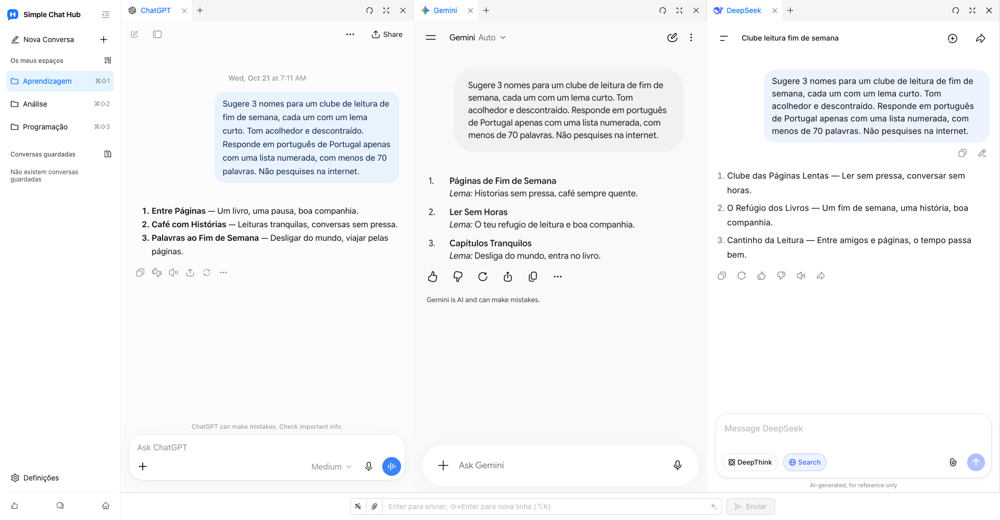

  

# Simple Chat Hub

**Uma pergunta. Respostas de IA lado a lado.**

[Site](https://chathub.aipilot.cc/?lang=pt-PT) · [Comentários](https://chathub.aipilot.cc/feedback?lang=pt-PT) · [Histórico de alterações](CHANGELOG.md)

[English](README.md) · [简体中文](README_CN.md) · [繁體中文](README_TW.md) · [Español](README_ES.md) · [العربية](README_AR.md) · [Русский](README_RU.md) · [Français](README_FR.md) · [Deutsch](README_DE.md) · **[Português (Portugal)](README_PT_PT.md)** · [Português (Brasil)](README_PT_BR.md) · [日本語](README_JA.md) · [한국어](README_KO.md)

O Simple Chat Hub reúne os sites do ChatGPT, Gemini, DeepSeek, Doubao, Kimi e de outras plataformas de IA lado a lado numa janela. Escreve uma vez no campo comum: cada plataforma recebe a pergunta e responde. Continua a conversa naquela em que quiseres aprofundar o tema.

Usas os sites das plataformas com as contas em que já tens sessão iniciada. Não precisas de chave API nem de criar uma conta no Simple Chat Hub.

Interface real do produto

## Formas de utilizar

- **Compreender um conceito.** Pergunta qual a diferença entre correlação e causalidade, compara exemplos e explicações e continua na plataforma que explicar melhor.
- **Analisar informação.** Dá o mesmo relatório semanal a várias IA. Compara os pontos principais e as questões a verificar e consulta depois os documentos originais.
- **Investigar um problema técnico.** Pergunta por que razão uma página envia duas vezes o mesmo pedido API. Compara as abordagens e aprofunda uma delas.

## Funcionalidades

- **Uma pergunta, respostas lado a lado.** Envia a mesma pergunta a todas as plataformas do espaço atual pelo campo comum. Anexa ficheiros selecionando-os, colando-os ou arrastando-os.
- **Conversas independentes.** Cada plataforma mantém o seu contexto. Continua no campo próprio de cada uma ou usa apenas uma plataforma.
- **Espaços por tarefa.** Guarda combinações para aprender, analisar ou programar. Escolhe nomes e ícones e muda com atalhos. Usa vários separadores por coluna, ajusta as larguras e recolhe a barra lateral.
- **Guardar e retomar conversas.** Guarda as ligações das conversas atuais e a disposição das plataformas e regressa com um clique.
- **Biblioteca de prompts.** Guarda instruções habituais e insere-as com um clique ou atalho. A otimização de prompts ajuda a exprimir as ideias com mais clareza.
- **Capturas longas.** Guarda uma conversa completa de uma plataforma numa imagem com largura adequada a computador ou telemóvel.
- **Lançamento a partir de outras ferramentas.** Copia uma ligação no menu do espaço e configura-a no Alfred ou noutro lançador. Abre o Hub com uma pergunta para enviar automaticamente ou apenas preencher.
- **Mais pormenores.** Mais de 30 plataformas de IA chinesas e internacionais integradas, sites personalizados, atalhos configuráveis, temas claro e escuro e 12 idiomas de interface.

## Instalação

**Aplicação para computador** · Windows / macOS / Linux

[Descarregar app](https://chathub.aipilot.cc/?lang=pt-PT#download) · [GitHub Releases](https://github.com/jackyr/simple-chat-hub-extension/releases)

Os instaladores para macOS e Windows ainda não estão assinados com um certificado de programador, e a versão para macOS também não foi autenticada pela Apple. Ao instalar ou abrir a aplicação pela primeira vez, o sistema pode indicar que não consegue verificar o programador ou o editor. Obtenha os instaladores na página oficial de transferências ou na secção GitHub Releases deste projeto. No macOS, abra o DMG e mova a aplicação para Aplicações. Se a primeira abertura for bloqueada, confirme que confia na origem da transferência e abra Definições do Sistema → Privacidade e Segurança. Desloque-se até Segurança e escolha Abrir mesmo assim; confirme a abertura e autentique-se se solicitado.

Instale a extensão a partir da loja oficial do seu navegador:

- [Chrome Web Store](https://chromewebstore.google.com/detail/dpfkgaedamhcmkkgeiajeggihmfjhhlj)
- [Microsoft Edge Add-ons](https://microsoftedge.microsoft.com/addons/detail/simple-chat-hub/plaobjkecadfmaglmhdaolohmckjgnom)
- [Firefox Add-ons](https://addons.mozilla.org/firefox/addon/simple-chat-hub/)

Para uma instalação offline, transfira um pacote da [lista de ficheiros do repositório](https://github.com/jackyr/simple-chat-hub-extension): `.crx.zip` para Chrome / Edge ou `.xpi.zip` para Firefox. Extraia o arquivo antes da instalação. A instalação manual está sujeita às restrições do navegador e do sistema operativo; recomenda-se a utilização das lojas oficiais.

## Primeiros passos

1. Instala a extensão e clica no ícone do Simple Chat Hub na barra de ferramentas do navegador.
2. Inicia sessão nas plataformas em cada coluna. Se não conseguires iniciar sessão aí, faz isso num novo separador do navegador e atualiza a coluna.
3. Escolhe a combinação de plataformas e guarda-a como espaço.
4. Pergunta no campo comum, lê as respostas lado a lado e continua onde quiseres aprofundar.

A extensão é gratuita. As contas, subscrições, quotas e condições de rede são definidas por cada plataforma. O preenchimento e o envio automáticos dependem da estrutura dos sites. Após alterações, poderá ser temporariamente necessário enviar manualmente; mantemos a compatibilidade através de atualizações de configuração. O envio de anexos também depende da plataforma. Algumas, como o Grok, não funcionam normalmente na extensão: usa a aplicação de computador ou abre-as num novo separador.

## Abrir o Hub a partir do Alfred ou de outro lançador

1. Coloque o cursor sobre o espaço pretendido na barra lateral e escolha **Copiar ligação de arranque** no respetivo menu.
2. Cole a ligação na ação de URL do lançador. A ligação já inclui o endereço do Hub da sua instalação e as plataformas selecionadas.
3. Configure o lançador para substituir `{query}` pela pergunta, codificada uma única vez para URL, e abrir um **novo separador** no navegador e perfil onde a extensão está instalada.
4. A ligação copiada inclui `send=1` para enviar a pergunta quando as plataformas estiverem prontas. Remova `send=1` para preencher o campo partilhado sem enviar.

Utilize a ligação que copiou: os endereços das extensões variam consoante o navegador, o perfil e o método de instalação. Consulte as [perguntas frequentes do site](https://chathub.aipilot.cc/?lang=pt-PT#faq) para mais informações.

## Plataformas

As plataformas incluídas abrangem ChatGPT, Gemini, Claude, DeepSeek, Copilot, Grok, Perplexity, Qwen, Kimi, Doubao, Yuanbao, Mistral, Meta e Z.ai, entre outras. Também pode adicionar sites personalizados nas definições.

## Dados e privacidade

Os seus dados pessoais, incluindo espaços, entradas da biblioteca de prompts e ligações para conversas guardadas, são armazenados localmente. As perguntas e os anexos são enviados para as plataformas de IA que escolher.

Utilizamos o Google Analytics para recolher anonimamente estatísticas básicas de utilização da interface (como cliques em botões e atalhos de teclado) e de erros, para melhorar o produto.

Ao otimizar um prompt, o texto introduzido é enviado para os servidores do Simple Chat Hub para processamento. Não recolhemos nem armazenamos esse texto.

## Comentários

Comunique um problema ou proponha melhorias através da [página de comentários](https://chathub.aipilot.cc/feedback?lang=pt-PT) ou do [GitHub Issues](https://github.com/jackyr/simple-chat-hub-extension/issues). Ao comunicar um erro, indique a plataforma, o navegador, a versão da extensão e os passos para reproduzir o problema.

## Donativos

O desenvolvimento e a manutenção exigem tempo e esforço. Se gosta da extensão ou a considera útil, ofereça-me um café!

| [Buy Me A Coffee](https://buymeacoffee.com/jackyrao)                                                                          | [PayPal](https://paypal.me/jackyrao)                                                                             | WeChat                                                  |
| ----------------------------------------------------------------------------------------------------------------------------- | ---------------------------------------------------------------------------------------------------------------- | ------------------------------------------------------- |
|  |  |  |

## Doadores

Obrigado a quem apoia o projeto! O vosso apoio ajuda a mantê-lo em desenvolvimento.

[Ver a lista de doadores](DONORS.md)
