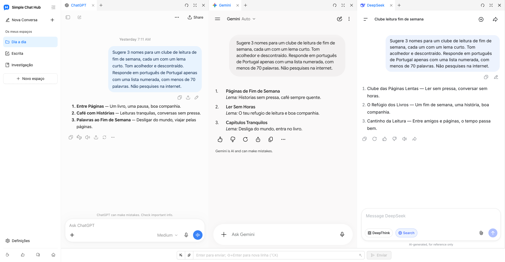

  

# Simple Chat Hub

**As suas IA favoritas, no mesmo lugar.**

[Site](https://chathub.aipilot.cc/?lang=pt-PT) · [Comentários](https://chathub.aipilot.cc/feedback?lang=pt-PT) · [Histórico de alterações](CHANGELOG.md)

[English](README.md) · [简体中文](README_CN.md) · [繁體中文](README_TW.md) · [Español](README_ES.md) · [العربية](README_AR.md) · [Русский](README_RU.md) · [Français](README_FR.md) · [Deutsch](README_DE.md) · **[Português (Portugal)](README_PT_PT.md)** · [Português (Brasil)](README_PT_BR.md) · [日本語](README_JA.md) · [한국어](README_KO.md)

O Simple Chat Hub reúne o ChatGPT, o Gemini, o DeepSeek e outras plataformas de IA num espaço de trabalho. Converse nos sites originais que já conhece ou envie a mesma pergunta a várias IA e leia as respostas lado a lado para conhecer diferentes perspetivas.

Menos procurar onde começar, menos alternar entre separadores. Usar IA no dia a dia fica um pouco mais simples.

Captura real do produto com o novo esquema de espaços e logótipo, e conversas reais no ChatGPT, Gemini e DeepSeek.

## Funcionalidades

- **Um só lugar. Pergunte em simultâneo.** Mantenha as suas plataformas habituais por perto. Converse com cada uma individualmente ou escreva uma só vez para perguntar a várias IA e continuar depois cada conversa em separado.
- **Espaços para as suas tarefas.** Guarde diferentes combinações de plataformas para escrita, investigação e utilização diária. Personalize os nomes e ícones dos espaços e organize as páginas em grupos e separadores.
- **Mais espaço para as respostas.** Arraste os limites das colunas para ajustar a largura, altere a ordem das colunas e dos separadores ou recolha a barra lateral para facilitar a leitura.
- **Bons prompts, prontos a reutilizar.** Guarde instruções úteis na biblioteca de prompts e recupere-as quando precisar. A otimização de prompts também pode ajudar a expressar uma ideia com mais clareza.
- **Conversas guardadas numa só imagem longa.** Capture uma conversa de uma única plataforma e abra uma pré-visualização local para a rever, organizar ou partilhar.
- **Menos ações repetidas.** Defina os seus atalhos de teclado e envie ficheiros anexos através do campo de entrada partilhado nas plataformas compatíveis.
- **Abra a partir de outras ferramentas.** Adicione a ligação de arranque de um espaço ao Alfred ou a outro lançador para abrir o Hub com uma pergunta, pronta a editar ou a enviar automaticamente.
- **Mantenha as suas contas habituais.** Abra os sites originais das plataformas de IA, adicione sites personalizados e escolha entre temas claro e escuro e 12 idiomas de interface. Não é necessária uma conta Hub nem uma chave API. A extensão é gratuita.

## Instalação

Instale a extensão a partir da loja oficial do seu navegador:

- [Chrome Web Store](https://chromewebstore.google.com/detail/dpfkgaedamhcmkkgeiajeggihmfjhhlj)
- [Microsoft Edge Add-ons](https://microsoftedge.microsoft.com/addons/detail/simple-chat-hub/plaobjkecadfmaglmhdaolohmckjgnom)
- [Firefox Add-ons](https://addons.mozilla.org/firefox/addon/simple-chat-hub/)

Para uma instalação offline, transfira um pacote da [lista de ficheiros do repositório](https://github.com/jackyr/simple-chat-hub-extension): `.crx.zip` para Chrome / Edge ou `.xpi.zip` para Firefox. Extraia o arquivo antes da instalação. A instalação manual está sujeita às restrições do navegador e do sistema operativo; recomenda-se a utilização das lojas oficiais.

## Primeiros passos

1. Instale a extensão e abra o Simple Chat Hub.
2. Escolha as suas plataformas favoritas e organize-as em espaços.
3. Inicie sessão quando necessário e converse em cada plataforma ou utilize o campo partilhado para perguntar a várias IA em simultâneo.

As contas, subscrições, limites de utilização e requisitos de rede são definidos por cada plataforma de IA. A incorporação de páginas, o envio partilhado, o envio de ficheiros e as capturas de conversas dependem da plataforma, do estado da sessão e da ligação à rede. Se uma plataforma exigir autenticação ou verificação, conclua esse processo primeiro num separador independente.

## Abrir o Hub a partir do Alfred ou de outro lançador

1. Coloque o cursor sobre o espaço pretendido na barra lateral e escolha **Copiar ligação de arranque** no respetivo menu.
2. Cole a ligação na ação de URL do lançador. A ligação já inclui o endereço do Hub da sua instalação e as plataformas selecionadas.
3. Configure o lançador para substituir `{query}` pela pergunta, codificada uma única vez para URL, e abrir um **novo separador** no navegador e perfil onde a extensão está instalada.
4. A ligação copiada inclui `send=1` para enviar a pergunta quando as plataformas estiverem prontas. Remova `send=1` para preencher o campo partilhado sem enviar.

Utilize a ligação que copiou: os endereços das extensões variam consoante o navegador, o perfil e o método de instalação. Consulte as [perguntas frequentes do site](https://chathub.aipilot.cc/?lang=pt-PT#faq) para mais informações.

## Plataformas

As plataformas incluídas abrangem ChatGPT, Gemini, Claude, DeepSeek, Copilot, Grok, Perplexity, Qwen, Kimi, Doubao, Yuanbao, Mistral, Meta e Z.ai, entre outras. Também pode adicionar sites personalizados nas definições.

## Dados e privacidade

- Os espaços, prompts guardados, atalhos e preferências são guardados no armazenamento de extensões do navegador.
- As perguntas, os anexos e as conversas enviados às plataformas de IA são tratados por essas plataformas segundo as respetivas políticas.
- Quando utiliza a otimização de prompts, o prompt atual é enviado para o serviço de otimização da extensão.
- A extensão solicita informações de configuração e versão e envia um identificador de instalação, eventos de utilização e informações de erros para estatísticas de utilização e diagnóstico. Os comentários e os questionários enviam as informações submetidas.

## Comentários

Comunique um problema ou proponha melhorias através da [página de comentários](https://chathub.aipilot.cc/feedback?lang=pt-PT) ou do [GitHub Issues](https://github.com/jackyr/simple-chat-hub-extension/issues). Ao comunicar um erro, indique a plataforma, o navegador, a versão da extensão e os passos para reproduzir o problema.

## Donativos

O desenvolvimento e a manutenção exigem tempo e esforço. Se gosta da extensão ou a considera útil, ofereça-me um café!

| [Buy Me A Coffee](https://buymeacoffee.com/jackyrao)                                                                          | [PayPal](https://paypal.me/jackyrao)                                                                             | WeChat                                                  |
| ----------------------------------------------------------------------------------------------------------------------------- | ---------------------------------------------------------------------------------------------------------------- | ------------------------------------------------------- |
|  |  |  |

## Doadores

Obrigado a quem apoia o projeto! O vosso apoio ajuda a mantê-lo em desenvolvimento.

[Ver a lista de doadores](DONORS.md)
