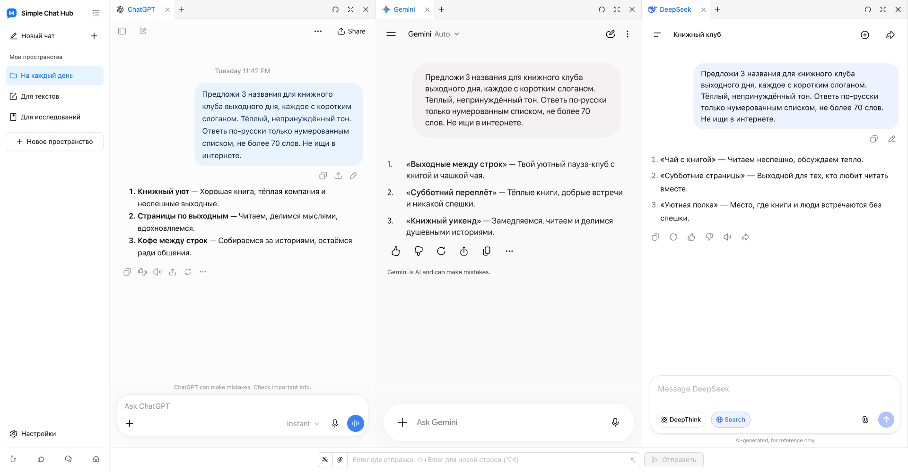

  

# Simple Chat Hub

**Любимые ИИ — в одном месте.**

[Сайт](https://chathub.aipilot.cc/?lang=ru) · [Обратная связь](https://chathub.aipilot.cc/feedback?lang=ru) · [История изменений](CHANGELOG.md)

[English](README.md) · [简体中文](README_CN.md) · [繁體中文](README_TW.md) · [Español](README_ES.md) · [العربية](README_AR.md) · **[Русский](README_RU.md)** · [Français](README_FR.md) · [Deutsch](README_DE.md) · [Português (Portugal)](README_PT_PT.md) · [Português (Brasil)](README_PT_BR.md) · [日本語](README_JA.md) · [한국어](README_KO.md)

Simple Chat Hub собирает ChatGPT, Gemini, DeepSeek и другие ИИ-платформы в одном рабочем пространстве. Общайтесь на знакомых оригинальных сайтах или отправляйте один вопрос нескольким ИИ и читайте ответы рядом, чтобы рассмотреть разные точки зрения.

Меньше поиска нужной страницы и переключений между вкладками. Пользоваться ИИ каждый день становится проще.

Настоящий снимок интерфейса с новой компоновкой пространств и логотипом, а также реальными диалогами в ChatGPT, Gemini и DeepSeek.

## Возможности

- **Одно место. Вопрос всем сразу.** Держите любимые платформы под рукой. Общайтесь с каждой отдельно или введите вопрос один раз, чтобы задать его нескольким ИИ, а затем продолжить каждый разговор независимо.
- **Пространства для ваших задач.** Сохраняйте разные сочетания платформ для текстов, исследований и повседневных дел. Задавайте пространствам названия и значки, объединяйте страницы в группы и вкладки.
- **Больше места для ответов.** Перетаскивайте границы, чтобы менять ширину колонок, переставляйте колонки и вкладки или сворачивайте боковую панель для удобного чтения.
- **Удачные промпты всегда под рукой.** Сохраняйте полезные инструкции в библиотеке промптов и вызывайте их при необходимости. Оптимизация промптов поможет яснее выразить вашу мысль.
- **Диалог в одном длинном изображении.** Сделайте длинный снимок разговора на одной платформе и откройте локальный предпросмотр, чтобы вернуться к нему, упорядочить материалы или поделиться ими.
- **Меньше повторяющихся действий.** Настраивайте сочетания клавиш и отправляйте файлы через общее поле ввода на совместимых платформах.
- **Запуск из других инструментов.** Добавьте ссылку запуска пространства в Alfred или другую программу запуска, чтобы открыть Hub с вопросом для редактирования или автоматической отправки.
- **Привычные аккаунты остаются с вами.** Открывайте оригинальные сайты ИИ-платформ, добавляйте свои сайты и выбирайте светлую или тёмную тему и один из 12 языков интерфейса. Аккаунт Hub и API-ключ не нужны. Расширение бесплатно.

## Установка

Установите расширение из официального магазина вашего браузера:

- [Chrome Web Store](https://chromewebstore.google.com/detail/dpfkgaedamhcmkkgeiajeggihmfjhhlj)
- [Microsoft Edge Add-ons](https://microsoftedge.microsoft.com/addons/detail/simple-chat-hub/plaobjkecadfmaglmhdaolohmckjgnom)
- [Firefox Add-ons](https://addons.mozilla.org/firefox/addon/simple-chat-hub/)

Для установки без подключения к магазину скачайте пакет из [списка файлов репозитория](https://github.com/jackyr/simple-chat-hub-extension): `.crx.zip` для Chrome / Edge или `.xpi.zip` для Firefox. Распакуйте архив перед установкой. Ручная установка зависит от ограничений браузера и операционной системы; рекомендуется использовать официальные магазины.

## Начало работы

1. Установите расширение и откройте Simple Chat Hub.
2. Выберите любимые платформы и организуйте их в пространства.
3. При необходимости войдите в аккаунты, затем общайтесь на каждой платформе или задайте вопрос нескольким ИИ через общее поле ввода.

Аккаунты, подписки, лимиты использования и требования к сети определяются каждой ИИ-платформой. Встраивание страниц, общая отправка, отправка файлов и снимки диалогов зависят от платформы, состояния входа и сети. Если требуется вход или проверка, сначала пройдите её в отдельной вкладке.

## Открытие Hub из Alfred и других программ запуска

1. Наведите указатель на нужное пространство в боковой панели и выберите **Копировать ссылку запуска** в его меню.
2. Вставьте ссылку в действие открытия URL вашей программы запуска. Она уже содержит адрес Hub для вашей установки и выбранные платформы.
3. Настройте замену `{query}` на вопрос, закодированный для URL ровно один раз, и открытие **новой вкладки** в браузере и профиле, где установлено расширение.
4. Скопированная ссылка содержит `send=1` для отправки после готовности платформ. Удалите `send=1`, чтобы только заполнить общее поле ввода без отправки.

Используйте собственную скопированную ссылку: адреса расширений различаются в зависимости от браузера, профиля и способа установки. Подробнее — в [ответах на частые вопросы на сайте](https://chathub.aipilot.cc/?lang=ru#faq).

## Платформы

Среди встроенных платформ — ChatGPT, Gemini, Claude, DeepSeek, Copilot, Grok, Perplexity, Qwen, Kimi, Doubao, Yuanbao, Mistral, Meta и Z.ai. Свои сайты можно добавить в настройках.

## Данные и конфиденциальность

- Пространства, сохранённые промпты, сочетания клавиш и настройки хранятся в хранилище расширений браузера.
- Вопросы, вложения и разговоры, отправленные ИИ-платформам, обрабатываются этими платформами по их собственным правилам.
- При использовании оптимизации промптов текущий промпт отправляется в сервис оптимизации расширения.
- Расширение запрашивает конфигурацию и сведения о версии, а также отправляет идентификатор установки, события использования и сведения об ошибках для статистики и диагностики. При отправке отзывов и анкет передаются предоставленные сведения.

## Обратная связь

Сообщить о проблеме или предложить улучшение можно через [форму обратной связи](https://chathub.aipilot.cc/feedback?lang=ru) или [GitHub Issues](https://github.com/jackyr/simple-chat-hub-extension/issues). В сообщении об ошибке укажите платформу, браузер, версию расширения и шаги для воспроизведения.

## Пожертвования

Разработка и поддержка требуют времени и сил. Если расширение вам нравится или помогает, угостите меня чашкой кофе!

| [Buy Me A Coffee](https://buymeacoffee.com/jackyrao)                                                                          | [PayPal](https://paypal.me/jackyrao)                                                                             | WeChat                                                  |
| ----------------------------------------------------------------------------------------------------------------------------- | ---------------------------------------------------------------------------------------------------------------- | ------------------------------------------------------- |
|  |  |  |

## Благодарности

Спасибо всем, кто поддерживает проект! Ваша помощь позволяет продолжать его развитие.

[Посмотреть список поддержавших проект](DONORS.md)
