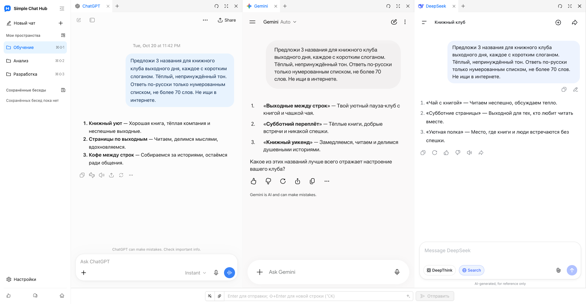

  

# Simple Chat Hub

**Один вопрос. Ответы ИИ рядом.**

[Сайт](https://chathub.aipilot.cc/?lang=ru) · [Обратная связь](https://chathub.aipilot.cc/feedback?lang=ru) · [История изменений](CHANGELOG.md)

[English](README.md) · [简体中文](README_CN.md) · [繁體中文](README_TW.md) · [Español](README_ES.md) · [العربية](README_AR.md) · **[Русский](README_RU.md)** · [Français](README_FR.md) · [Deutsch](README_DE.md) · [Português (Portugal)](README_PT_PT.md) · [Português (Brasil)](README_PT_BR.md) · [日本語](README_JA.md) · [한국어](README_KO.md)

Simple Chat Hub размещает сайты ChatGPT, Gemini, DeepSeek, Doubao, Kimi и других ИИ-платформ рядом в одном окне. Введите вопрос один раз в общем поле: каждая платформа получит его и ответит. Продолжайте диалог там, где хотите разобраться глубже.

Вы пользуетесь сайтами платформ и своими аккаунтами, в которые уже вошли. API-ключ и регистрация в Simple Chat Hub не нужны.

Реальный интерфейс продукта

## Варианты использования

- **Разобраться в понятии.** Спросите, чем корреляция отличается от причинности. Сравните примеры и объяснения и задайте уточнения там, где ответ понятнее всего.
- **Проанализировать материал.** Передайте нескольким ИИ один и тот же недельный отчёт команды. Сравните ключевые выводы и вопросы для проверки, затем сверьтесь с исходными данными.
- **Найти техническую ошибку.** Спросите, почему страница отправляет один API-запрос дважды. Сравните способы диагностики и изучите один подробнее.

## Возможности

- **Один вопрос, ответы рядом.** Отправляйте одинаковый вопрос всем платформам текущего пространства через общее поле. Добавляйте файлы выбором, вставкой или перетаскиванием.
- **Независимые диалоги.** Каждая платформа сохраняет свой контекст. Задавайте уточнения в её поле ввода или используйте только одну платформу.
- **Пространства по задачам.** Сохраняйте наборы для учёбы, анализа и программирования. Выбирайте названия и значки и переключайтесь сочетаниями клавиш. Размещайте несколько вкладок в колонке, меняйте ширину и сворачивайте боковую панель.
- **Сохранение и продолжение бесед.** Сохраняйте ссылки на текущие диалоги и расположение платформ и возвращайтесь к ним одним нажатием.
- **Библиотека запросов.** Сохраняйте частые инструкции и вставляйте нажатием или сочетанием клавиш. Оптимизация запросов помогает яснее выразить мысли.
- **Длинные скриншоты.** Сохраняйте полный диалог одной платформы в изображение с шириной для компьютера или телефона.
- **Запуск из других инструментов.** Скопируйте ссылку в меню пространства и настройте её в Alfred или другом лаунчере. Открывайте Hub с вопросом для автоотправки или только подстановки.
- **Другие возможности.** Более 30 встроенных китайских и международных ИИ-платформ, добавление своих сайтов, настраиваемые сочетания клавиш, светлая и тёмная темы и 12 языков интерфейса.

## Установка

**Приложение для компьютера** · Windows / macOS / Linux

[Скачать приложение](https://chathub.aipilot.cc/?lang=ru#download) · [GitHub Releases](https://github.com/jackyr/simple-chat-hub-extension/releases)

Установочные файлы для macOS и Windows пока не подписаны сертификатом разработчика, а версия для macOS не прошла нотариальное заверение Apple. При первой установке или запуске система может сообщить, что не удалось проверить разработчика или издателя. Скачивайте установочные файлы со страницы загрузок официального сайта или из раздела GitHub Releases этого проекта. В macOS откройте файл DMG и переместите приложение в папку «Программы». Если первый запуск заблокирован, убедитесь, что доверяете источнику загрузки, затем откройте «Системные настройки → Конфиденциальность и безопасность», прокрутите до раздела «Безопасность» и выберите «Всё равно открыть». Подтвердите открытие и при необходимости пройдите проверку подлинности.

Установите расширение из официального магазина вашего браузера:

- [Chrome Web Store](https://chromewebstore.google.com/detail/dpfkgaedamhcmkkgeiajeggihmfjhhlj)
- [Microsoft Edge Add-ons](https://microsoftedge.microsoft.com/addons/detail/simple-chat-hub/plaobjkecadfmaglmhdaolohmckjgnom)
- [Firefox Add-ons](https://addons.mozilla.org/firefox/addon/simple-chat-hub/)

Для установки без подключения к магазину скачайте пакет из [списка файлов репозитория](https://github.com/jackyr/simple-chat-hub-extension): `.crx.zip` для Chrome / Edge или `.xpi.zip` для Firefox. Распакуйте архив перед установкой. Ручная установка зависит от ограничений браузера и операционной системы; рекомендуется использовать официальные магазины.

## Начало работы

1. Установите расширение и нажмите значок Simple Chat Hub на панели браузера.
2. Войдите в нужные платформы в их колонках. Если войти в колонке не удаётся, сделайте это в новой вкладке браузера, затем обновите колонку.
3. Выберите набор платформ и сохраните его как пространство.
4. Задайте вопрос в общем поле, прочитайте ответы рядом и продолжайте на интересующей платформе.

Расширение бесплатно. Аккаунты, подписки, лимиты и сетевые требования определяет каждая платформа. Автозаполнение и отправка зависят от структуры сайтов. После изменений может временно потребоваться ручная отправка; мы поддерживаем совместимость обновлениями конфигурации. Отправка вложений также зависит от платформы. Некоторые платформы, например Grok, не работают нормально в расширении: используйте приложение для компьютера или новую вкладку.

## Открытие Hub из Alfred и других программ запуска

1. Наведите указатель на нужное пространство в боковой панели и выберите **Копировать ссылку запуска** в его меню.
2. Вставьте ссылку в действие открытия URL вашей программы запуска. Она уже содержит адрес Hub для вашей установки и выбранные платформы.
3. Настройте замену `{query}` на вопрос, закодированный для URL ровно один раз, и открытие **новой вкладки** в браузере и профиле, где установлено расширение.
4. Скопированная ссылка содержит `send=1` для отправки после готовности платформ. Удалите `send=1`, чтобы только заполнить общее поле ввода без отправки.

Используйте собственную скопированную ссылку: адреса расширений различаются в зависимости от браузера, профиля и способа установки. Подробнее — в [ответах на частые вопросы на сайте](https://chathub.aipilot.cc/?lang=ru#faq).

## Платформы

Среди встроенных платформ — ChatGPT, Gemini, Claude, DeepSeek, Copilot, Grok, Perplexity, Qwen, Kimi, Doubao, Yuanbao, Mistral, Meta и Z.ai. Свои сайты можно добавить в настройках.

## Данные и конфиденциальность

Ваши персональные данные, включая пространства, записи библиотеки промптов и ссылки на сохранённые диалоги, хранятся локально. Вопросы и вложения отправляются на выбранные вами ИИ-платформы.

Мы используем Google Analytics для анонимного сбора базовой статистики использования интерфейса (например, нажатий кнопок и сочетаний клавиш) и ошибок, чтобы улучшать продукт.

При оптимизации промпта введённый текст отправляется на серверы Simple Chat Hub для обработки. Мы не собираем и не сохраняем этот текст.

## Обратная связь

Сообщить о проблеме или предложить улучшение можно через [форму обратной связи](https://chathub.aipilot.cc/feedback?lang=ru) или [GitHub Issues](https://github.com/jackyr/simple-chat-hub-extension/issues). В сообщении об ошибке укажите платформу, браузер, версию расширения и шаги для воспроизведения.

## Пожертвования

Разработка и поддержка требуют времени и сил. Если расширение вам нравится или помогает, угостите меня чашкой кофе!

| [Buy Me A Coffee](https://buymeacoffee.com/jackyrao)                                                                          | [PayPal](https://paypal.me/jackyrao)                                                                             | WeChat                                                  |
| ----------------------------------------------------------------------------------------------------------------------------- | ---------------------------------------------------------------------------------------------------------------- | ------------------------------------------------------- |
|  |  |  |

## Благодарности

Спасибо всем, кто поддерживает проект! Ваша помощь позволяет продолжать его развитие.

[Посмотреть список поддержавших проект](DONORS.md)
