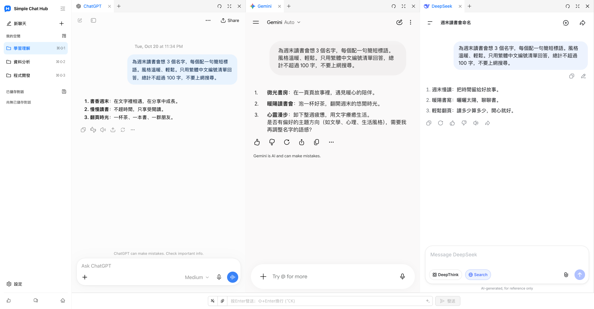

  

# Simple Chat Hub

**一次提問，多個 AI 並排回答。**

[官方網站](https://chathub.aipilot.cc/?lang=zh-TW) · [問題回饋](https://chathub.aipilot.cc/feedback?lang=zh-TW) · [更新紀錄](CHANGELOG.md)

[English](README.md) · [简体中文](README_CN.md) · **[繁體中文](README_TW.md)** · [Español](README_ES.md) · [العربية](README_AR.md) · [Русский](README_RU.md) · [Français](README_FR.md) · [Deutsch](README_DE.md) · [Português (Portugal)](README_PT_PT.md) · [Português (Brasil)](README_PT_BR.md) · [日本語](README_JA.md) · [한국어](README_KO.md)

Simple Chat Hub 把 ChatGPT、Gemini、DeepSeek、豆包、Kimi 等 AI 平台的網頁版並排放在同一個視窗。在統一輸入欄寫一次問題，各平台同時收到並作答；想深入哪個，就在哪個平台接著聊。

用的就是各平台網頁版與你已登入的帳號，不需要 API Key，也不需要註冊 Simple Chat Hub 帳號。

實際產品介面

## 可以這樣使用

- **理解一個概念。**例如問「相關性與因果關係有什麼區別」，對照不同例子與解釋，在講得最清楚的平台繼續追問。
- **整理一份資料。**把同一份團隊週報交給多個 AI，對照各自整理的重點與待查證問題，再回到原始資料核對。
- **排查技術問題。**例如問「網頁為什麼把同一個 API 請求送了兩次」，比較不同的排查思路，選一個方向深入。

## 主要功能

- **一次提問，並排對照。**用統一輸入欄把同一個問題傳給目前空間的所有平台，並排顯示回答。可以附加檔案，點選、貼上或拖入都可以。
- **各自接著聊。**每個平台保留自己的對話上下文，可以在任一平台的輸入框單獨追問，也可以只使用其中一個平台。
- **依任務整理空間。**為學習、資料分析、程式開發等任務儲存不同的平台組合，自訂名稱與圖示，用快捷鍵切換。一欄可以放多個平台分頁，拖曳分欄調整欄寬，側欄也能收起。
- **儲存對話，隨時接著聊。**儲存各平台目前的對話連結與排列，之後一鍵回到原來的對話。
- **提示詞庫。**儲存常用指令，點選或用快捷鍵填入；也可以用提示詞最佳化，讓想法表達得更清楚。
- **對話長圖。**把單一平台的完整對話儲存為長圖，可選擇適合電腦或手機閱讀的寬度。
- **從外部工具開啟。**在空間選單複製呼叫連結，設定到 Alfred 等啟動器，帶著問題開啟 Hub，自動傳送或只填入問題。
- **更多細節。**內建 30 多個中國及國際 AI 平台，也可以新增自訂網站；支援自訂快捷鍵、淺色與深色主題，以及 12 種介面語言。

## 安裝

**桌面用戶端** · Windows / macOS / Linux

[下載用戶端](https://chathub.aipilot.cc/?lang=zh-TW#download) · [GitHub Releases](https://github.com/jackyr/simple-chat-hub-extension/releases)

目前，macOS 和 Windows 安裝套件均未使用開發者憑證簽署，macOS 版也未經 Apple 公證。首次安裝或開啟時，系統可能提示無法驗證開發者或發行者。請從官方網站的下載區或本專案的 GitHub Releases 取得安裝套件。 在 macOS 上，打開 DMG 並將 App 拖入「應用程式」。如果首次開啟遭到阻擋，請先確認下載來源可信，再前往「系統設定 → 隱私權與安全性」，向下捲動至「安全性」並按一下「仍要打開」；再次確認開啟，並依提示驗證身分。

從瀏覽器官方擴充功能商店安裝：

- [Chrome Web Store](https://chromewebstore.google.com/detail/dpfkgaedamhcmkkgeiajeggihmfjhhlj)
- [Microsoft Edge Add-ons](https://microsoftedge.microsoft.com/addons/detail/simple-chat-hub/plaobjkecadfmaglmhdaolohmckjgnom)
- [Firefox Add-ons](https://addons.mozilla.org/firefox/addon/simple-chat-hub/)

需要離線安裝時，可從[儲存庫檔案清單](https://github.com/jackyr/simple-chat-hub-extension)下載對應安裝包：Chrome / Edge 使用 `.crx.zip`，Firefox 使用 `.xpi.zip`，解壓縮後安裝。手動安裝受瀏覽器及作業系統限制，建議優先使用官方商店。

## 開始使用

1. 安裝擴充功能，點擊瀏覽器工具列的 Simple Chat Hub 圖示開啟。
2. 在各欄登入需要的平台。如果某個平台無法在欄內登入，先在瀏覽器的新分頁登入，再回來重新整理該欄。
3. 選好平台組合，儲存為自己的空間。
4. 在統一輸入欄提問，並排閱讀回答，在想深入的平台繼續追問。

擴充功能免費。各平台的帳號、訂閱、使用額度與網路需求由平台決定。自動填入與傳送依賴各平台網頁的結構，個別平台改版後可能暫時需要手動傳送，我們會透過設定更新持續支援；附件能否成功傳送也取決於平台本身。少數平台（如 Grok）無法在擴充功能中正常使用，可以改用桌面用戶端或在新分頁開啟。

## 從 Alfred 等外部工具開啟 Hub

1. 將滑鼠移到側欄中的目標空間，在選單中選擇**複製呼叫連結**。
2. 將連結貼到啟動器的 URL 操作中。連結已包含目前安裝的 Hub 位址和所選平台。
3. 讓工具把 `{query}` 替換為僅經過一次 URL 編碼的問題，並在安裝了擴充功能的瀏覽器及設定檔中**開啟新分頁**。
4. 複製的連結預設帶有 `send=1`，會在平台就緒後自動傳送；刪除 `send=1` 則只填入統一輸入欄，供你繼續編輯。

請使用自己複製的連結，不同瀏覽器、設定檔和安裝方式的擴充功能位址可能不同。更多說明見[官網常見問題](https://chathub.aipilot.cc/?lang=zh-TW#faq)。

## 支援的平台

內建 ChatGPT、Gemini、Claude、DeepSeek、Copilot、Grok、Perplexity、千問、Kimi、豆包、元寶、Mistral、Meta、Z.ai 等平台，也可以在設定中新增自訂網站。

## 資料與隱私說明

你的空間、提示詞庫和已儲存對話連結等個人資料均保存在本機。提問和附件會傳送給你選擇的 AI 平台。

我們會透過 Google Analytics 匿名收集基本的介面使用統計（如按鈕點擊、快捷鍵）和錯誤統計，用於改進產品。

使用「最佳化提示詞」時，輸入的文字會傳送至 Simple Chat Hub 伺服器處理，我們不會收集或儲存這些資料。

## 問題回饋

可以透過[回饋頁面](https://chathub.aipilot.cc/feedback?lang=zh-TW)或 [GitHub Issues](https://github.com/jackyr/simple-chat-hub-extension/issues)回報問題、提出建議。回報故障時，請附上平台、瀏覽器、擴充功能版本及重現步驟。

## 贊助

開發維護不易，如果你喜歡這個擴充功能或覺得有幫助，請我喝一杯咖啡吧！

| [Buy Me A Coffee](https://buymeacoffee.com/jackyrao)                                                                          | [PayPal](https://paypal.me/jackyrao)                                                                             | 微信                                                  |
| ----------------------------------------------------------------------------------------------------------------------------- | ---------------------------------------------------------------------------------------------------------------- | ----------------------------------------------------- |
|  |  |  |

## 贊助者

感謝專案的贊助者！你的支持幫助我持續開發與維護。

[查看贊助者名單](DONORS.md)
