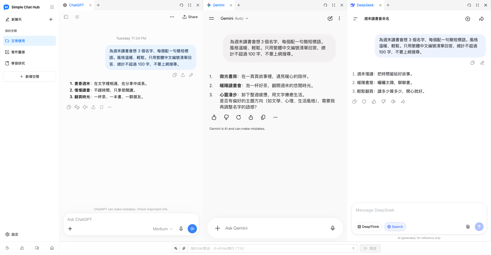

  

# Simple Chat Hub

**常用的 AI，在一起更順手。**

[官方網站](https://chathub.aipilot.cc/?lang=zh-TW) · [問題回饋](https://chathub.aipilot.cc/feedback?lang=zh-TW) · [更新紀錄](CHANGELOG.md)

[English](README.md) · [简体中文](README_CN.md) · **[繁體中文](README_TW.md)** · [Español](README_ES.md) · [العربية](README_AR.md) · [Русский](README_RU.md) · [Français](README_FR.md) · [Deutsch](README_DE.md) · [Português (Portugal)](README_PT_PT.md) · [Português (Brasil)](README_PT_BR.md) · [日本語](README_JA.md) · [한국어](README_KO.md)

Simple Chat Hub 把 ChatGPT、Gemini、DeepSeek 等 AI 平台放進同一個工作空間。你可以直接在熟悉的平台頁面裡對話，也可以把同一個問題同時傳給多個 AI，並排閱讀回答，參考不同思路。

少找入口，少切分頁。讓日常使用 AI 更簡單。

實際產品截圖，展示新版空間配置與 logo，以及 ChatGPT、Gemini、DeepSeek 中的真實對話。

## 主要功能

- **集中使用，同時提問。** 把常用平台放在眼前，隨時開啟、個別對話。需要多一種觀點時，輸入一次，就能同時向多個平台提問，再到各平台繼續追問。
- **依任務整理自己的空間。** 為寫作、研究和日常使用儲存不同的平台組合，自訂空間名稱與圖示，使用群組和分頁整理頁面。
- **為回答留出合適的位置。** 拖曳分欄邊界調整欄寬，拖曳排列分欄與分頁，也可以收起側欄，讓回答更好讀。
- **好提示詞，下次直接用。** 將常用指令儲存到提示詞庫，需要時直接呼叫。也可以使用提示詞最佳化，把已有的想法表達得更清楚。
- **有用的對話，留成一張長圖。** 把單一平台的對話儲存成長圖，在本機開啟預覽，方便回顧、整理與分享。
- **少做重複操作。** 設定適合自己的快捷鍵，並在相容的平台上透過統一輸入欄傳送檔案附件。
- **從外部工具帶著問題開啟。** 將空間呼叫連結設定到 Alfred 等啟動器中，帶著問題開啟 Hub，自動傳送或先填入再編輯。
- **沿用熟悉的平台與帳號。** 直接開啟各 AI 平台的原站，支援新增自訂網站，切換淺色、深色主題及 12 種介面語言。擴充功能免費，無需註冊 Hub 帳號，也不需要 API Key。

## 安裝

從瀏覽器官方擴充功能商店安裝：

- [Chrome Web Store](https://chromewebstore.google.com/detail/dpfkgaedamhcmkkgeiajeggihmfjhhlj)
- [Microsoft Edge Add-ons](https://microsoftedge.microsoft.com/addons/detail/simple-chat-hub/plaobjkecadfmaglmhdaolohmckjgnom)
- [Firefox Add-ons](https://addons.mozilla.org/firefox/addon/simple-chat-hub/)

需要離線安裝時，可從[儲存庫檔案清單](https://github.com/jackyr/simple-chat-hub-extension)下載對應安裝包：Chrome / Edge 使用 `.crx.zip`，Firefox 使用 `.xpi.zip`，解壓縮後安裝。手動安裝受瀏覽器及作業系統限制，建議優先使用官方商店。

## 開始使用

1. 安裝擴充功能，開啟 Simple Chat Hub。
2. 選擇常用平台，整理成自己的空間。
3. 在需要的平台完成登入，直接對話或透過統一輸入欄嘗試同時提問。

各 AI 平台的帳號、訂閱、使用額度和網路要求仍由平台決定。頁面嵌入、同步傳送、檔案傳送及對話截圖的可用性取決於具體平台、登入狀態和網路環境。平台需要登入或驗證時，請先在獨立分頁中完成。

## 從 Alfred 等外部工具開啟 Hub

1. 將滑鼠移到側欄中的目標空間，在選單中選擇**複製呼叫連結**。
2. 將連結貼到啟動器的 URL 操作中。連結已包含目前安裝的 Hub 位址和所選平台。
3. 讓工具把 `{query}` 替換為僅經過一次 URL 編碼的問題，並在安裝了擴充功能的瀏覽器及設定檔中**開啟新分頁**。
4. 複製的連結預設帶有 `send=1`，會在平台就緒後自動傳送；刪除 `send=1` 則只填入統一輸入欄，供你繼續編輯。

請使用自己複製的連結，不同瀏覽器、設定檔和安裝方式的擴充功能位址可能不同。更多說明見[官網常見問題](https://chathub.aipilot.cc/?lang=zh-TW#faq)。

## 支援的平台

內建 ChatGPT、Gemini、Claude、DeepSeek、Copilot、Grok、Perplexity、千問、Kimi、豆包、元寶、Mistral、Meta、Z.ai 等平台，也可以在設定中新增自訂網站。

## 資料與隱私

- 空間、提示詞庫、快捷鍵和偏好設定儲存在瀏覽器擴充功能儲存空間中。
- 傳送給 AI 平台的問題、附件及對話由相應平台依其政策處理。
- 主動使用提示詞最佳化時，目前的提示詞會傳送至擴充功能的最佳化服務。
- 擴充功能會請求設定和版本資訊，並傳送安裝識別碼、功能使用事件及錯誤資訊，用於使用統計與故障排除。回饋與問卷會傳送所提交的資訊。

## 問題回饋

可以透過[回饋頁面](https://chathub.aipilot.cc/feedback?lang=zh-TW)或 [GitHub Issues](https://github.com/jackyr/simple-chat-hub-extension/issues)回報問題、提出建議。回報故障時，請附上平台、瀏覽器、擴充功能版本及重現步驟。

## 贊助

開發維護不易，如果你喜歡這個擴充功能或覺得有幫助，請我喝一杯咖啡吧！

| [Buy Me A Coffee](https://buymeacoffee.com/jackyrao)                                                                          | [PayPal](https://paypal.me/jackyrao)                                                                             | 微信                                                  |
| ----------------------------------------------------------------------------------------------------------------------------- | ---------------------------------------------------------------------------------------------------------------- | ----------------------------------------------------- |
|  |  |  |

## 贊助者

感謝專案的贊助者！你的支持幫助我持續開發與維護。

[查看贊助者名單](DONORS.md)
